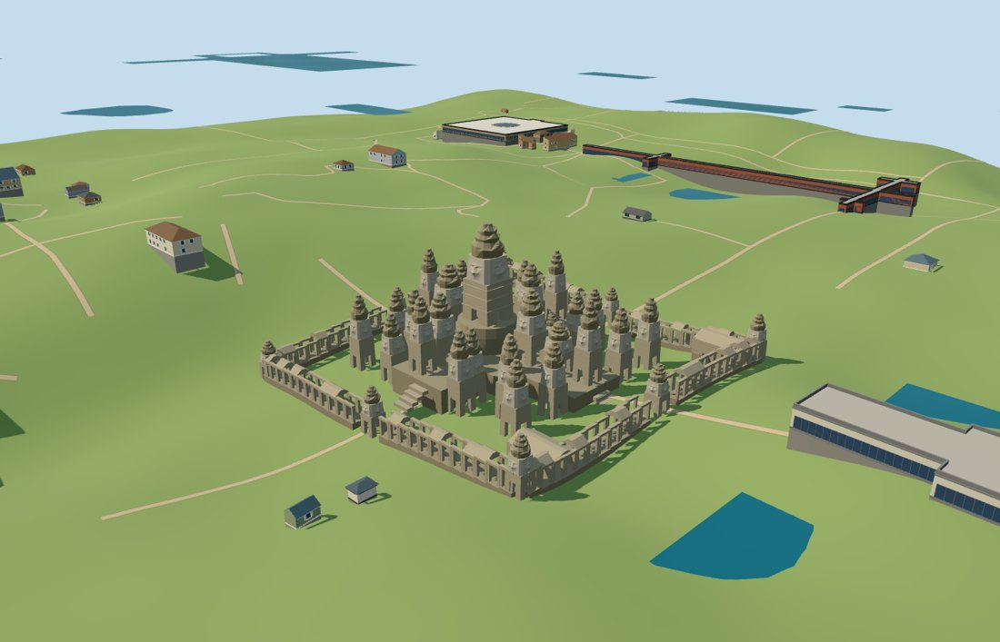

# bayon — Bayon

Reviewed 2026-10-18. Accepted for the specific medium-fi temple exterior and approximate standard-map/DEM fit.

## Exterior and shared materials

Inspected all 11 current portable views. The mapped outer compound, cruciform raised platform, taller central sanctuary, staggered face-tower cluster, open colonnades and interrupted gallery roofs distinguish Bayon. Two separately mapped eastern libraries remain separate forms within the gallery compound. Near levels use actual four-sided facial relief: broad noses, cheeks, downcast eyelids, shallow smiling lips and elongated ears; these are faceted visualization geometry, not photo decals. The first draft had an oversized square central head and too many complete gallery roofs; the central lower core, head proportions and broken roof rhythm were revised against the ordinary pictures.

Inspected all 11 current shared-material views. Three common 256-square ashlar, sandstone-grain and dry-stone material graphs use metric UVs and linear tints. Three near draws and one skyline draw; no embedded images, unique atlas or model-specific image load. Each material graph loads once and eviction frees model geometry. The shared flat stage exposes terrain-following foundation depth and does not establish geographic contact.

## Browser levels

| Level | Triangles | Bytes | Draws |
| --- | ---: | ---: | ---: |
| skyline | 972 | 106700 | 1 |
| district | 3890 | 387396 | 3 |
| street | 15720 | 1666816 | 3 |
| closeup | 42784 | 4753856 | 3 |

Inspected all 27 current medium-fi frames: street, block and skyline ranges beside procedural buildings at noon and late afternoon, Economy and High, untextured silhouette, six architectural details, four whole-temple levels and all transitions. The standard context camera scale was widened to 2.2 so procedural neighbors remain visible at street range. Skyline 972 triangles preserves the compound and clustered tower mass; district 3890 adds coarse mapped faces and sparse colonnades; street 15720 adds open portals, selected facial shape and grouped bays; closeup 42784 refines the faces and stepped lotus crowns. Initial skyline plus district geometry is 494096 bytes, plus three shared material graphs. Separate attribute streams prevent duplicate GPU uploads. Close-range shape changes between coarse and detailed face/crown levels remain visible; physical-device and dense-city measurements are pending.

## Geographic fit

Reviewed approximate full-site placement on the unchanged 161-square/6m standard DEM. Raw east/south coordinates preserve the nearly cardinal gallery grid and eastern approach. The opaque cruciform platform supports the principal cluster. Gallery supports, outer tower feet and library foundations extend below sampled terrain; district gallery supports include extra depth for their longer grouped bays. No terrain or water excavation is requested. Full-site loading replaces 12 temple records and preserves all 52 independent buildings in the 960m tile exactly. Eight native water features retain 438179.1610115951 square metres. Failure retains all 64 native buildings; eviction preserves surfaces and frees model geometry. A synthetic 64m partial tile retains original terrain beneath clipped pieces. Its empty semantic context checks clipping/lifecycle only; temporary cut faces are not permanent temple geometry. Coarse canopy-influenced DEM levels are not archaeological survey elevations.

## Scope and limitations

Accepted for the specific medium-fi Bayon exterior and approximate normal-map/DEM placement. Twelve standard-map records control the outer compound, inner cruciform platform, eight principal tower parts and two eastern libraries. The 37 rendered tower forms include 29 secondary position/height estimates from ordinary pictures and a modern explanatory layout whose caption explicitly says upper-terrace dimensions are approximate. This is not a surveyed current tower, face or damage inventory. The nominal 43m central top, subsidiary heights, crown tiers, face proportions, roof survivors, stairs and archaeological thresholds remain visualization estimates. Exact carvings, inscriptions, lichen patterns, navigable interiors, surrounding monuments and historic complete roofs are outside scope. Coarse canopy-influenced terrain does not resolve the actual archaeological paving levels. No bespoke survey or archival research was used.

## Source and checks

Two registered recipes plus retained map, terrain and picture-reference metadata rebuild the source master and four browser levels. Master: 54,624 triangles / 6,557,380 bytes. Six Khronos checks have zero errors/warnings. All 18 height/relief/opening probes, 128 mapped exterior/courtyard vertices and 824 platform samples pass. Inspected 49 official and 24 site/failure/partial frames. Bulk images stay local.

The source retains all 89 building records in the local map plan; 12 are explicitly authored and the other 77 remain independent. The actual 960m production tile contains 64 of those records. No ground or water excavation is requested. Foundation depth was corrected for the longer district gallery bays, outer towers and sloped library footprints before final captures.

Selected reproducibility checks, strict medium-fi audit, scene validation and a 30-tick simulation pass. No full corpus rebuild, dependency audit, Git mutation or upload was performed.

Rebuild: node packages/worldgen/scripts/generate-additional-landmarks.mjs --ids=bayon; node packages/worldgen/scripts/import-structure-models.mjs --ids=bayon; node packages/tooling/scripts/generate-landmark-lods.mjs --ids=bayon.

Source: sha256:b150b83822611039fafe580d92110f3b1647de14f8dfcf8655de5e2f34c41cc9

Runtime: sha256:d83e2391b3fdd9e42798808ae7698a440b9c97699fbdf173c7171eb11af3bc15

Input: sha256:c324c47590b85cde8a2e901f539fc987b344202c55924e2168c8000100b46ebe

## Ordinary picture references

https://commons.wikimedia.org/wiki/File:Bayon,_Angkor_Thom,_Camboya,_2013-08-17,_DD_37.JPG — Diego Delso, 17 August 2013, CC BY-SA 3.0; viewed only.

https://commons.wikimedia.org/wiki/File:Bayon_0759_(27773814040).jpg — Sasha India, 26 March 2010, CC BY 2.0; viewed only.

https://commons.wikimedia.org/wiki/File:Bay%C3%B3n_Temple_english.jpg — Tomas Bilbao Plasencia, 27 July 2021, CC BY-SA 4.0; viewed only. Modern explanatory layout with explicitly approximate upper-terrace dimensions; not an archaeological survey or proof of the present damage inventory. No picture pixels are shipped.
