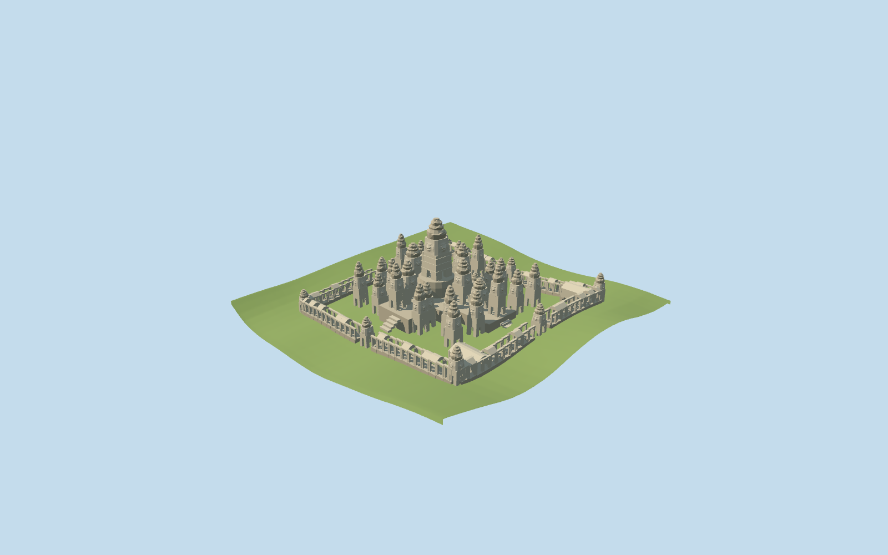

# Bayon

Specific Bayon exterior: actual outer gallery compound and inner cruciform platform, a43m central stepped sanctuary, seven other mapped principal tower parts, two separately mapped eastern libraries and29 picture/layout-guided secondary tower estimates. Four-sided shallow stone face reliefs carry the identity near the camera. Open colonnades, surviving lintels, interrupted gallery roofs, cardinal approaches and terraces remain distinct. Independent nearby buildings are preserved.

## Evidence and reconstruction

Published dimensions and reconstructed details are separated in spec.json. Primary references:

- [Reference](https://commons.wikimedia.org/wiki/File:Bayon,_Angkor_Thom,_Camboya,_2013-08-17,_DD_37.JPG)
- [Reference](https://commons.wikimedia.org/wiki/File:Bayon_0759_(27773814040).jpg)
- [Reference](https://commons.wikimedia.org/wiki/File:Bay%C3%B3n_Temple_english.jpg)

Three shared256-square stone graphs, metric UVs and linear tints. Facial relief is original faceted geometry, not a unique texture or copied photograph. Two registered recipes rebuild the master and browser levels.

## Model and axes

54,624 triangles; 163,872 vertices; 3 material groups; 6,557,380 bytes. Native bounds: -37.813, -6.990, -50.202 to 77.006, 43.290, 56.712. Source hash: `sha256:b150b83822611039fafe580d92110f3b1647de14f8dfcf8655de5e2f34c41cc9`.

{"x":"east","y":"up","z":"south"}

Retain the unchanged161-square/6m standard Mapzen-USGS grid and36.679m reference datum. The cruciform platform has a complete opaque top; its foundation feet and gallery supports extend below local standard terrain. Local gallery/tower bases follow coarse terrain samples. No ground or water excavation is requested; surveyed archaeological levels remain unknown.

## Reproduce

Run `node packages/worldgen/scripts/generate-additional-landmarks.mjs --ids=bayon` (or add `--check`). The generator preserves manually edited masters by checking their baseline hashes. Import through the standard authored-model workflow with optimization disabled; then capture all QA cameras, including shared-surface views.

## Pending work

- Specific Bayon exterior: actual outer gallery compound and inner cruciform platform, a43m central stepped sanctuary, seven other mapped principal tower parts, two separately mapped eastern libraries and29 picture/layout-guided secondary tower estimates. Four-sided shallow stone face reliefs carry the identity near the camera. Open colonnades, surviving lintels, interrupted gallery roofs, cardinal approaches and terraces remain distinct. Independent nearby buildings are preserved.
- Q654024/relation6990223 and standard PMTiles compound52776565123471 define the approximately121-by113m outer gallery. Inner building52776569058355 preserves its21-point cruciform platform; eight independent tower parts fix principal centers, including the19-point central sanctuary. Two mapped buildings on either side of the eastern entrance match the ordinary article’s courtyard libraries. Raw east/south coordinates preserve the almost cardinal grid and eastern approach. The ordinary modern layout picture guides secondary tower distribution within the inner cluster and at outer gopuras; its caption explicitly says the upper terrace dimensions are approximate. Tower/face inventories are not surveyed.
- The ordinary article gives a43m central tower and37 surviving towers, but does not establish an exact present inventory. The main tower retains the nominal43m top above its datum. Other tower heights, subsidiary positions, stepped crowns, damaged roof sections and facial relief are picture-guided approximations. Fine carvings, exact stone/lichen inventories, inscriptions and historical complete roofs are omitted.
- Retain the unchanged161-square/6m standard Mapzen-USGS grid and36.679m reference datum. The cruciform platform has a complete opaque top; its foundation feet and gallery supports extend below local standard terrain. Local gallery/tower bases follow coarse terrain samples. No ground or water excavation is requested; surveyed archaeological levels remain unknown.
- Secondary tower positions, exact face counts, library roofs and damaged gallery sections are visualization estimates. The ordinary modern layout picture has approximate upper-terrace dimensions; it is not a surveyed present inventory. Fine carvings, lichen, inscriptions, individual damaged stones and hidden interiors are omitted. Current visual/site acceptance is pending.

This bundle follows the medium-fi standard. Medium-fi appearance and geographic fit are reviewed separately. Hash-bound visual acceptance is recorded separately after capture inspection.

## Additional geographic data

©OpenStreetMap contributors; Protomaps; Mapzen/USGS terrain.
