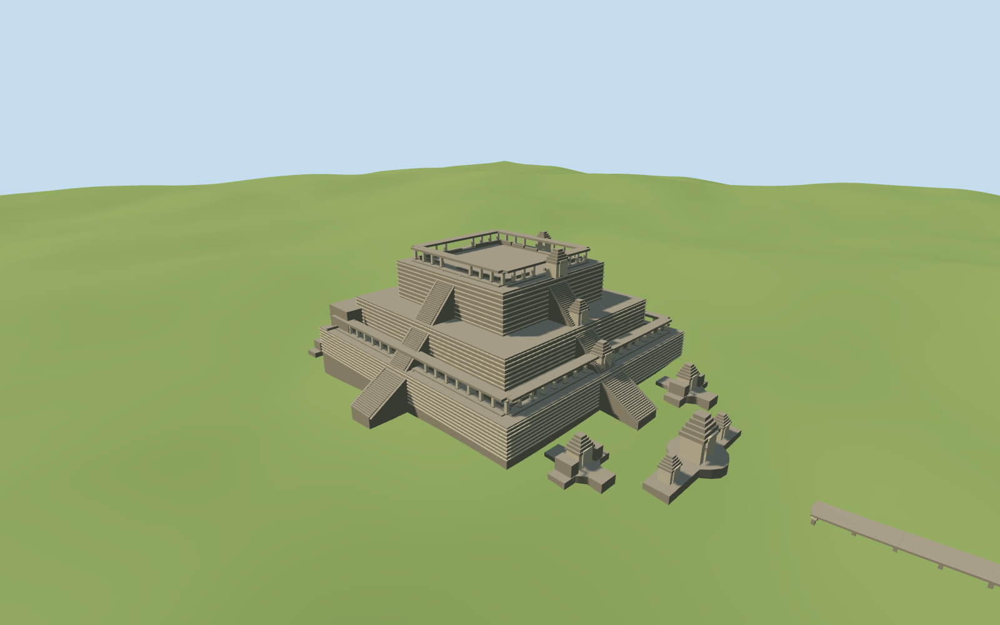

# N0513 — Baphuon

Reviewed 2026-10-19. Accepted for medium-fi present-day exterior and approximate standard-map fit. Built, inspected, corrected and completed in one continuous round.

## Architecture

Inspected all current portable, shared, medium-fi and actual-site renders in this continuous authoring round. Baphuon has three steep terraces, cardinal stairs, roofless lintel galleries, surviving entrance crowns, an open summit without the lost central tower, the west-wall reclining Buddha, four outer cruciform pavilions, eastern gopura and the long cross-shaped raised eastern causeway. Fixed floating main/stair foundations and reshaped the initially tubular Buddha as a supported block relief. The detailed source, browser levels and the site were checked together; no separate retrospective research/re-evaluation queue is created.

## Shared materials

Three reused 256² graphs: coursed sandstone, raw sandstone and weathered limestone. Metric UVs and linear neutral tints, no embedded images or unique atlas. Each graph loads once, model draws stay at three, geometry is released on eviction. The flat shared stage exposes buried foundations because the long causeway spans a different native terrain height; it is a material inspection stage. Actual-site captures use the retained unmodified terrain for contact review.

## Browser levels

| Level | Triangles | Bytes | Draws |
| --- | ---: | ---: | ---: |
| skyline | 858 | 89348 | 1 |
| district | 3654 | 338800 | 3 |
| street | 14138 | 1311968 | 3 |
| closeup | 18148 | 1689768 | 3 |

Inspected all 25 medium-fi frames, including noon/late light, Economy/High, street/block/skyline, untextured silhouette, four details, four explicit authored levels and transitions. Levels 858 / 3,654 / 14,138 / 18,148 triangles, initial geometry 428,148 bytes. Separate GPU attribute streams avoid duplicate uploads. The skyline causeway follows the same coarse terrain profile as the nearer levels. Generic street context is centered on the long compound and crops part of the temple at the left; the dedicated east/west detail and all explicit LOD cameras inspect the complete temple. Physical-device and dense-city timings remain pending.

## Geographic fit

Q790118/way240141751 identifies the main temple. Nine pinned standard PMTiles records fix the main mound, upper sanctuary and entrance part, four cruciform outer pavilions, eastern gopura and long cross-shaped causeway. Raw +X east and +Z south at heading0 retain its slight mapped axis rotation; the east entrance/causeway resolves the facing direction. Bayon to the southeast, Phimeanakas to the north and the Terrace of the Elephants east/northeast remain independent. Reused unmodified nearby N0497 Bayon standard PMTiles/Mapzen extract. Main terrace foundations and outer pavilions extend into the native terrain; the causeway deck is segmented along the coarse native ground with supports seated at each segment. This intentionally accommodates the noisy standard DEM rather than claiming surveyed level causeway elevations. Ground and mapped water remain native; no ground or water cutout. Approximate native-terrain fit: buried main foundations and first stair footings, individually seated pavilion bases, a raised causeway deck and columns following the retained standard grid. Exact historic levels and horizontal flatness are not claimed. No terrain or water cutout. Nine temple map records are replaced to sub-1e-7m² residual boundary slivers while all 49 independent in-tile structures remain unchanged. Native ground and 530873.06m² of water remain unchanged; failed loading restores all 58 original records and eviction frees geometry.

## Scope and limits

Accepted as a medium-fi present-day exterior and approximate standard-map placement. Terrace heights, lost roof edges, individual damage, sculptural anatomy, support inventories and exact historic levels are visualization estimates. The causeway is deliberately fitted to the noisy native DEM; it is not a survey of level causeway elevations. No lost central sanctuary tower, complete bas-relief inventory, navigable interior or neighboring royal palace is reconstructed. Neighboring native procedural shells are preserved context, not verified reconstructions of those other monuments.

## Checks

Two registered recipes rebuild the 2,180,268-byte master. Six Khronos files: zero errors/warnings. 1,146 mesh contact/deck rays pass. Inspected 52 current views:9 portable, 9 shared, 25 medium-fi and 9 actual-site/fallback. Scene validation and sim 30 pass. Broad source reproducibility and lock refresh remain at the planned batch milestone near 525 complete. The prior N0512 renderer release gate remains pending that refresh.

Rebuild: node packages/worldgen/scripts/generate-additional-landmarks.mjs --ids=N0513; node packages/worldgen/scripts/import-next-1000-models.mjs --ids=N0513; node packages/tooling/scripts/generate-landmark-lods.mjs --ids=N0513 --force.

Source: sha256:e7bab795971b39b0557f1313c2a14f085240caa34ee65ed26e9ddacd935d6358

Runtime: sha256:f9a7ecb79b659d06a86fa06a6a36edee7460714a635b3b43b344be3c2928a013

Input: sha256:10ec2d3c387310bea408a62a873a57de9f1b4455f27ed7a7e6d02d6edc062c41

## Ordinary pictures

https://commons.wikimedia.org/wiki/File:20191210_Baphuon_Temple_exterior-6.jpg — Balon Greyjoy; 2019-12-10; CC0 1.0, per licensing section; viewed only. No pixels copied.

https://commons.wikimedia.org/wiki/File:20191210_Baphuon_Temple_reclining_Buddha-4.jpg — Balon Greyjoy; 2019-12-10; CC0 1.0, per licensing section; viewed only. No pixels copied.

https://commons.wikimedia.org/wiki/File:20191210_Baphuon_Temple_walkway-1.jpg — Balon Greyjoy; 2019-12-10; Viewed only; no pixels copied. No pixels copied.

https://commons.wikimedia.org/wiki/File:Baphuon_(6201946101).jpg — Jorge Láscar; 2011-01-11; CC BY 2.0; viewed only. No pixels copied.
