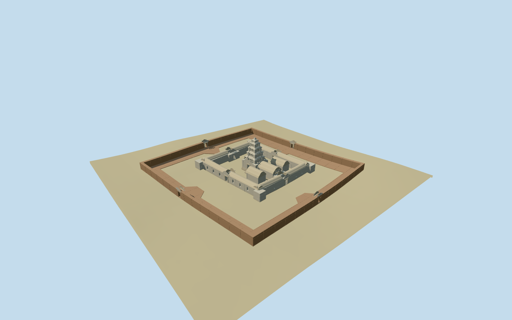

# N0529 — Banteay Samré

Reviewed2026-10-19 in one continuous author/build/inspect/fix round.

## Appearance

Inspected48 final current source/shared/medium-fi/native-site/fallback views in one continuous round. Specific mapped laterite outer enclosure, open sandstone inner gallery, tall stepped sanctuary crown with projecting miniature-storey frames, moulded plinth, eastern mandapa, paired libraries, corbelled roofs, original simplified pediment rims, stairs and real open passages. Same-round images prompted a stepped/redented crown replacing an overly smooth pyramid, frames that follow its taper, a wider doorway camera and retaining the stepped crown in skyline. The final skyline change preserved40 already inspected image hashes; the eight changed views were inspected. A dedicated whole-sanctuary camera covers the crown; the axial detail emphasizes the lower passage.

## Shared materials and browser levels

Two existing256-square graphs: stone_sandstone and stone_sandstone_raw, reused for sandstone, carved trim and warmer laterite tints. Metric UVs and linear muted colors; both graphs read once by the production resolver. No embedded images or unique atlas. Four levels876 /3978 /13708 /16828triangles; at most three draws, initial457020bytes. Separate GPU attribute streams and matching CPU/GPU byte accounting. All triangle/draw/download caps pass; eviction disposes all model geometry.

| Level | Triangles | Bytes | Draws |
| --- | ---: | ---: | ---: |
| skyline | 876 | 92984 | 1 |
| district | 3978 | 364036 | 3 |
| street | 13708 | 1305556 | 3 |
| closeup | 16828 | 1550432 | 3 |

Inspected noon/late, economy/high, full silhouettes, sanctuary/passage/enclosure details, all four levels and transitions. Skyline preserves the tower steps and both enclosure layouts; district simplifies distant gate trim, while street/close levels retain redented crown profiles, taper-following miniature facade frames and window recesses. Low courts remain open. Flat stages can expose terrain-relative feet; source terrain/native-site views carry contact judgment. The native fixture uses green fallback ground and standard procedural neighboring buildings, not a reconstruction of actual forest density, paving or neighboring facades.

## Approximate map fit

Exact-QID relation3045426 and standard native multipolygon52776561178674 fix the84x82m outer enclosure,43m inner gallery/courtyard and10x9m sanctuary control. Native east/south at heading0, internal architectural angle-0.100314380462rad. Outer courtyard notches and gallery jogs guide the eight open gates; eastern hall and paired library allocation, secondary dimensions and thresholds are picture-led approximations. Replace only the one corresponding native multipolygon using2cm numeric margin; all90 independent in-tile native buildings remain byte-equivalent at every level. Original six-meter terrain and water stay unchanged. Long enclosures/gallery bases follow sampled grade; each sanctuary/hall/library has a locally level plinth and buried foundation. Loaded levels retain90 native records; failed loading preserves91 originals; eviction restores ground/water and releases geometry.

## Limits

Accepted medium-fi visualization of Banteay Samre from four inspected ordinary pictures and standard PMTiles/Mapzen data. The extra complete tower picture filled a cropped-crown coverage gap; no bespoke survey/archive research. Sanctuary height18m, hall/library positions and secondary dimensions, miniature-storey inventory, roof survival, fine relief and exact paving/threshold levels are explicit approximations. Pediment and facade motifs are original broad forms; exact narrative sculpture, individual blocks, vegetation, furnishings and an archaeological conservation inventory are omitted. External paths/landscape remain host context. Physical-device and dense-city timings remain pending. A reusable Khmer geometry helper is new; earlier accepted recipes were not changed.

## Selected checks

Six Khronos files: zero errors/warnings.196 actual geometry/contact probes; 48 current inspected views. Scene validation/sim30 and strict selected medium-fi audit pass. Source and runtime hashes/material bindings/LOD caps verified.

Rebuild: node packages/worldgen/scripts/generate-additional-landmarks.mjs --ids=N0529; node packages/worldgen/scripts/import-next-1000-models.mjs --ids=N0529; node packages/tooling/scripts/generate-landmark-lods.mjs --ids=N0529 --force.

Source: sha256:ca78fc88308baac2e0ee36f6cc49c6457b8d35c03111b088359fc1b3bc60aa03

Runtime: sha256:8647d492c621904da12ebfb1733820f2aead0ddfb5f4d866418c4513dbecc704

Input: sha256:9b35d1ec3f994a664925ceddee63184be8a3343420ac4cb01ce71ec12708ba8e

## Viewed ordinary pictures

https://commons.wikimedia.org/wiki/File:Banteay_samre.jpg — 3coma14; CCBYSA3.0; viewed only. Viewed only; no pixels copied.

https://commons.wikimedia.org/wiki/File:022_Banteay_Samre_Temple_Doorways,_Cambodia.jpg — Anandajoti; CCBYSA3.0; viewed only. Viewed only; no pixels copied.

https://commons.wikimedia.org/wiki/File:Cambodia-2780_(3625344753).jpg — Dennis G. Jarvis; CCBYSA2.0; viewed only. Viewed only; no pixels copied.

https://commons.wikimedia.org/wiki/File:Banteay_samre_tower.JPG — Henry Flower; CCBYSA3.0; viewed only. Viewed only; no pixels copied.

## Source binding maintenance — 550 checkpoint

Exact prior input reconstructed using prior recipe list and preserved helper text. Seven helper edits change only the first comment line, making existing source recipes explicit. All six approved model files are unchanged. Existing visual acceptance is retained through byte-equivalent rebuilding; this is not a new visual review.

Previous input: sha256:9b35d1ec3f994a664925ceddee63184be8a3343420ac4cb01ce71ec12708ba8e

Current input: sha256:8e01f85a10a227102a4bd9e83e8e216984202d53f67162695bb040f44c780087
