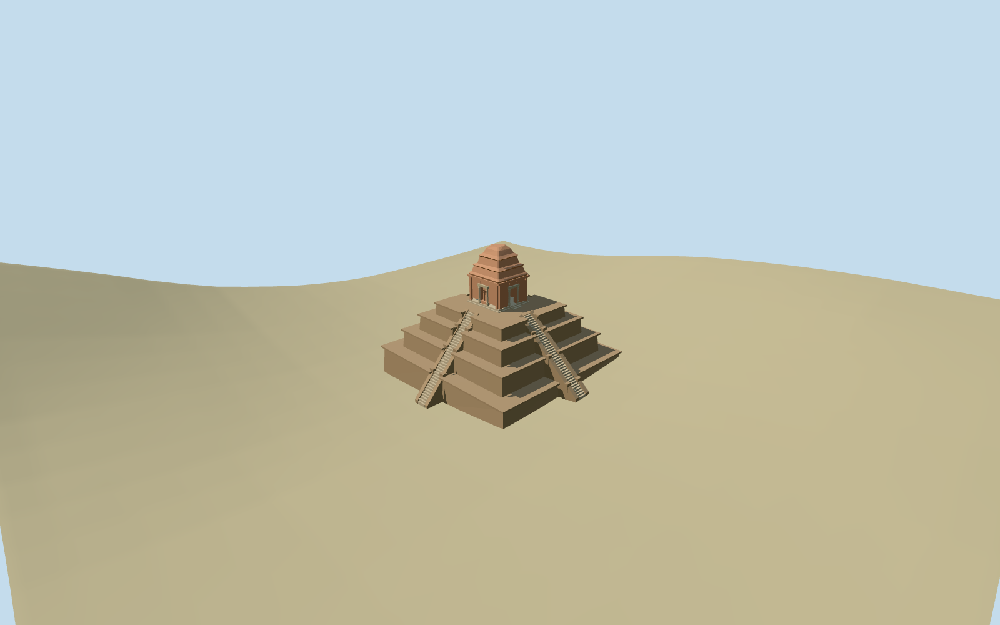

# N0530 — Baksei Chamkrong

Reviewed2026-10-19 in one continuous author/build/inspect/fix round.

## Appearance

Inspected48 current source/shared/medium-fi/native-site/fallback views in one continuous author/build/inspect/fix round. Four diminishing laterite terraces, four steep stone stairs with solid cheeks and terrace piers, level summit landing, east-facing open shrine doorway, three blind recesses, brick corner pilasters, moulded stone jambs/lintel, layered eaves and rough truncated crown. Skyline was reduced to998 triangles before rendering. Corrected a copied display title during this same round; eight changed shared views were inspected and the other40 views retained byte-identical inspected contact sheets. No separate research or re-evaluation round.

## Shared materials and browser levels

Three existing256-square graphs: stone_sandstone for stone/carved trim, stone_sandstone_raw for tinted laterite and brick_longformat for the warm shrine. Metric UVs and linear muted colors; every graph read once by the production resolver. Four levels998/2760/3660/3948triangles, at most four draws, initial359952bytes. No embedded images or unique atlas; separate GPU streams, matching CPU/GPU accounting and all triangle/draw/download caps pass. Eviction releases all geometry.

| Level | Triangles | Bytes | Draws |
| --- | ---: | ---: | ---: |
| skyline | 998 | 104084 | 1 |
| district | 2760 | 255868 | 4 |
| street | 3660 | 339184 | 4 |
| closeup | 3948 | 365536 | 4 |

Inspected noon/late, economy/high, whole silhouettes, shrine doorway and terrace/stair details, all four levels and transitions. Skyline keeps the four-tier layout, open doorway and tapered shrine while simplifying steps and cornices; district/street/close retain shrine trim and layered crown. Native-site views carry terrain-contact judgment; the flat material stage can expose the terrain-relative foundations. Fixture green ground and procedural neighbors are host context, not a reconstruction of forest, paving or neighboring facades.

## Approximate map fit

Exact-QID Q789081/way194604371 and lower/upper native controls35184566693203/35184991411523 identify the mapped pyramid, stair axes and offset summit shrine. Root heading0, internal angle+0.006281550563rad, open doorway east. Replace both matching shells with2cm numerical tolerance; all92 independent native building inputs remain byte-equivalent. Original6m terrain and water unchanged, no ground/water cutout or flattened precinct. First terrace bottom follows grade and is buried; upper terraces are level. Four stairs have separately sampled buried foundations. Loaded levels retain92 native records, failure restores94 originals, eviction releases geometry.

## Limits

Accepted medium-fi visualization from two inspected ordinary photos and standard PMTiles/Mapzen data. Tier elevations3.4/6.6/9.4/11.5m and shrine floor12m/crown9.2m above floor are photo-led approximations; the map upper height14/layer1 has an ambiguous datum. Individual tread counts, recess depths, crown erosion and carving are approximate. Coarse forest DEM varies about4m across the base and does not resolve archaeological paving or exact thresholds. Forecourt guardians, external path/forest, inscriptions and detailed sculpture are not authored. Physical-device/dense-city timings remain pending.

## Selected checks

Six Khronos files: zero errors/warnings.222 actual geometry/contact probes; 48 current inspected views. Scene validation/sim30 and strict selected medium-fi audit pass. Source and runtime hashes/material bindings/LOD caps verified.

Rebuild: node packages/worldgen/scripts/generate-additional-landmarks.mjs --ids=N0530; node packages/worldgen/scripts/import-next-1000-models.mjs --ids=N0530; node packages/tooling/scripts/generate-landmark-lods.mjs --ids=N0530 --force.

Source: sha256:7b68191567258a188c741a423fd4c42642f4836347e9a0fdd658a98f53f36ac7

Runtime: sha256:72a9908b2025d989799a121f629593e2c41f41bde93efec8b9bbacffb12e3b27

Input: sha256:50ce2f268db50fb2fad70ab75b0e750095cf5ceb9608e337691962e0b2a0168a

## Viewed ordinary pictures

https://commons.wikimedia.org/wiki/File:Baksei_Chamkrong.jpg — NeuCeu; CCBYSA3.0; viewed only. Viewed only; no pixels copied.

https://commons.wikimedia.org/wiki/File:Baksei_Chamkrong-2.JPG — Leon petrosyan; CCBYSA3.0; viewed only. Viewed only; no pixels copied.

## Source binding maintenance — 550 checkpoint

Exact prior input reconstructed using prior recipe list and preserved helper text. Seven helper edits change only the first comment line, making existing source recipes explicit. All six approved model files are unchanged. Existing visual acceptance is retained through byte-equivalent rebuilding; this is not a new visual review.

Previous input: sha256:50ce2f268db50fb2fad70ab75b0e750095cf5ceb9608e337691962e0b2a0168a

Current input: sha256:ced0d0936bfc00d67b7395e73a99e52af5799ba3b70e1ecdfa3a80a289880918
