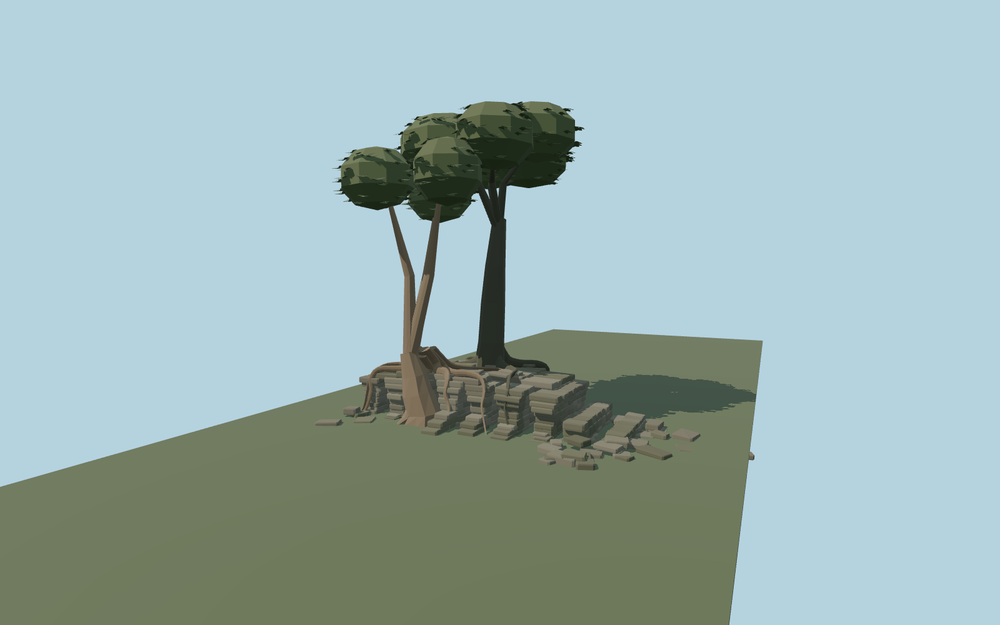
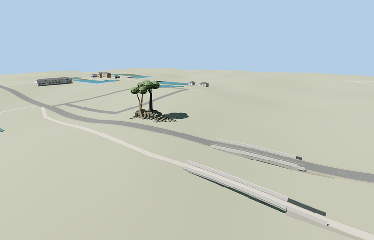

# Spean Thma

Reviewed 2026-11-18. **The photographed ruin is available in the world viewer.**

The south-side pier bases now step down over several moss-stained sandstone blocks. The adjoining corbel passages remain open, and the displaced paving and broken eastern apron remain visible. The pale tree has a continuous fork and the darker trunk is rooted on the retained paving. Both crowns stay attached at distance. The foliage is stylized and the modeled apron remains a photographic approximation. The shared material views show sandstone and bark under the same lighting as the other landmarks. The medium-fi distance views retain the two-tree silhouette and the low masonry. Sandstone and bark use the existing shared stone_sandstone_raw and wood_plain graphs.

| Detail level | Triangles | Bytes | Draws |
| --- | ---: | ---: | ---: |
| skyline | 870 | 92,180 | 1 |
| district | 2,888 | 308,948 | 3 |
| street | 9,348 | 1,022,076 | 3 |
| closeup | 39,196 | 4,619,148 | 3 |

The master rebuilds byte for byte at 55,144 triangles. Skyline and district together use 401,128 bytes. Six GLBs passed validation with zero embedded images. All 202 geometry probes passed. The review covered 44 exterior and distance views and 15 native scene views.

The ruin’s east–west axis follows the adjoining Petit Circuit approach as a local alignment proxy. The photographed corbel openings and two tree roots face toward the geotagged southwest viewpoint. The point location comes from the named PMTiles feature. The full surviving extent and the exact compass bearing remain approximate.

All 23 buildings, 24 road records, ground and water remained in the PMTiles and standard terrain fixture through four detail levels and simulated model failure. The two mapped modern crossings and their procedural support geometry were retained. Fifteen masonry base samples per loaded level were within 0.18 m of the terrain. Model and support geometry released on unload.

[2025 south-side photo](https://commons.wikimedia.org/wiki/File:Spean_Thma_-_Angkor_Archaeological_Park_2025_(1).jpg) · [Wider photo gallery](https://helloangkor.com/attractions/spean-thma-10/) · [QA](qa.json) · [Placement evidence](placement-report.json)
