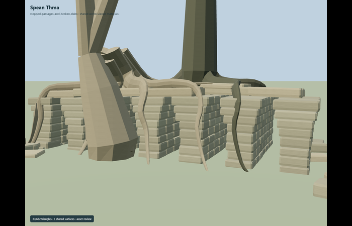
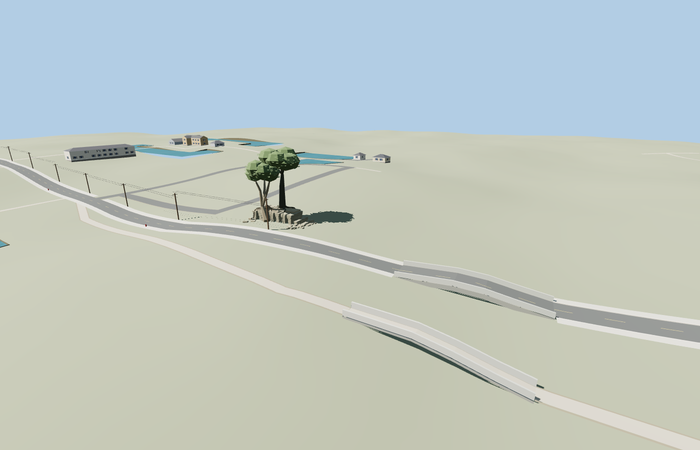

# Spean Thma

Reviewed2026-10-27. **Incomplete source draft; canonical placement disabled.**

Inspected59 current frames:11 portable,10 shared-material,23 medium-fi and15 native fixture. Replaced the regular radial root armature with editable creeping/branching paths and flattened curved buttresses; added a grounded knotted pale stump with a low three-way fork, a taller dark tree, and uneven stone-course heights. The first far silhouette probes mistakenly treated expected root occluders as masonry; their current checks isolate internal passages and find pier faces behind those roots. All166 geometry probes pass. The wider ordinary photographs show a collapsed extension beyond this partial source. The central/pier masonry remains too regular and the pale stump is still coarse; crown/scatter style, complete extant footprint and signed axis need work. No full unique-candidate completion is claimed.

Two existing shared 256px stone_sandstone_raw and wood_plain graphs, metric UVs and muted linear vertex tints. Three runtime semantic material groups; skyline is one tinted group. No embedded/private images or copied photo pixels. Each graph reads once per native scenario, and all geometry disposes. Opaque modeled leaf sprigs are a declared landmark-tree approximation; they do not use the standard native scatter-card atlas and still need style review.

| Level | Triangles | Bytes | Draws |
| --- | ---: | ---: | ---: |
| skyline | 530 | 57452 | 1 |
| district | 2408 | 259772 | 3 |
| street | 10872 | 1205396 | 3 |
| closeup | 43104 | 5010160 | 3 |

Source master 63652 triangles / 7640608 bytes. Runtime triangles 530 / 2408 / 10872 / 43104, bytes 57452 / 259772 / 1205396 / 5010160, draws 1 / 3 / 3 / 3. Initial skyline plus district 317224 bytes. All actual triangle budgets and separate GPU attribute streams pass. Physical-device timings are unmeasured. Passing budgets alone does not grant medium-fi approval.

Named PMTiles Spean Thmor bridge point 17592756541329 is about280m northeast of the old catalog coordinate and agrees with the recent photo location. Anchor[103.87960016727448,13.446213881078847], heading0.1342; +X ENE, +Z SSE. Only the point is map evidence; no outline, exact-QID match or measured ruin axis is claimed. Eight bays over16.8m, with six partially roofed passages and two broken channels, are provisional visible-remnant controls. The full surviving ruin extent and orientation remain unresolved. The isolated fixture explicitly enables the draft only for review; canonical default queries exclude it. No neighboring modern road/cycle bridge is replaced.

All23 resident buildings,24 road records, standard DEM, displayed ground and three input water features are retained across four loaded levels and load failure. The modern Petit Circuit road bridge35184391923932 and separate cycle bridge35185724126966 remain independent map features. Nine inset masonry-base samples per loaded level are supported within0.32m of the coarse ground; samples are inset from intentional depth joints and do not establish a surveyed footprint or road joins. No ground/building cutout, authored approach grade or support geometry. Unload disposes all model geometry.

## Remaining work

Root paths now creep and branch, and the forked stump is grounded. Further reduce the coarse stump and repeated pier regularity, resolve crown/scatter style, and extend the source to cover the complete extant collapsed remnant shown by the wider ordinary photographs. Establish the signed axis from the map/photo context. Preserve the reviewed source and runtime results; repeat only affected checks after changes. No bespoke terrain research is needed.

## Reconstruction limits

- Named PMTiles Spean Thmor bridge POI17592756541329, about280m northeast of the older catalog coordinate, agrees with the21July2025 photo location. No exact-QID outline or dimensional survey is present. Heading follows the nearby older east-west road corridor and the inferred photo-facing south side; approximate rather than independently surveyed. The8-bay,16.8m visible-remnant interpretation and broken outer extent are provisional reconstruction controls; photographs establish stepped corbels, broken slabs and two root systems, not a measured complete bay schedule.
- Only the photographed visible remnant segment is interpreted: six passages with partial upper corbels/slabs and two broken eastern channels/pier stubs. The full surviving ruin footprint, total bay count and hidden masonry remain unverified. This source draft is not a completed unique-candidate model.
- Two tree/root silhouettes are photo-led approximations, not botanical surveys. Portable GLBs use small opaque modeled leaf sprigs rather than alpha-card crowns; this avoids per-model atlases and unsupported portable shader bindings. Shared native scatter cards remain the standard for ordinary generated forest.
- Stone blocks, irregular course heights, explicitly drawn creeping root paths and tree proportions are authored deterministically. The current model remains only a visible-remnant draft. No downloaded mesh or copied photo pixels. Native ground and both modern crossings must remain unchanged.
- This is a photo-led surviving-ruin interpretation. No exact-QID outline, measured full bay schedule, complete hidden masonry, tree survey or verified full surviving footprint is available. Keep geographic/fidelity approval pending if the full extent and root-tree silhouette cannot be established in current inspection.
- Two existing shared 256px stone_sandstone_raw and wood_plain graphs; muted linear vertex colors supply stone variation and leaves. Opaque modeled leaf sprigs are an explicit portable landmark-tree exception to native scatter-card foliage, not a claim to use that atlas. No private textures, embedded images, downloaded meshes or copied photo pixels. Physical-device timings remain unmeasured.
