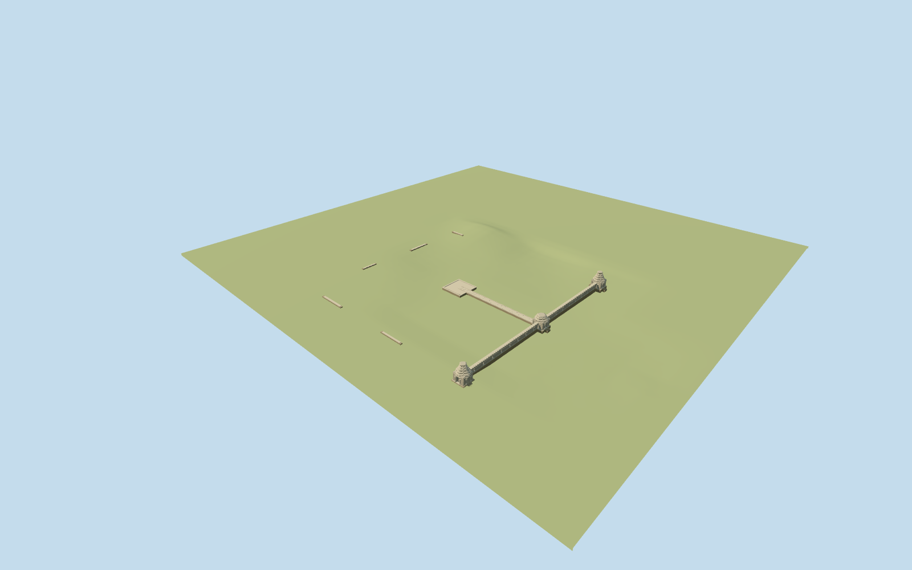

# west_mebon — West Mebon

Reviewed 2026-10-19 in one continuous author/build/inspect/fix round.

## Appearance

Inspected48 current source/shared/medium-fi/native/fallback views in the construction round. Specific pictured West Mebon: three east-wall gateways with two taller rounded tiered crowns and a lower broken crown, real east-west passages, stepped jamb shafts and original simplified leaf/scroll volumes; long capped wall has true rectangular perforations. Mapped narrow east-to-center causeway meets low square platform; sparse low bank fragments leave the pool and site open. First views caught inward-facing east/west trim; reversed that facade orientation and lowered local thresholds to1.3m above datum to reduce exposed footings. Rounded crowns, repeated ornament and fragment inventory are simplified picture-led approximations; no museum Vishnu or restored central shrine.

## Shared materials and browser levels

Three existing256-square graphs: stone_sandstone, stone_sandstone_raw and stone_ashlar. Each graph loaded once, metric UVs and linear tints, zero embedded images. Master17,048triangles/2,048,244bytes. Runtime levels996/3528/14104/17048triangles; skyline103568bytes, district337740bytes, street1327340bytes, closeup1615836bytes. Initial geometry441308bytes; at most three draws. Separate GPU streams and matching CPU/GPU accounting; model eviction releases geometry.

| Level | Triangles | Bytes | Draws |
| --- | ---: | ---: | ---: |
| skyline | 996 | 103568 | 1 |
| district | 3528 | 337740 | 3 |
| street | 14104 | 1327340 | 3 |
| closeup | 17048 | 1615836 | 3 |

Inspected current noon/late/economy/high context, silhouette, all four levels/transitions and three combined detail angles. Three gateways, open wall, causeway/platform survive skyline simplification; skyline uses four broader wall apertures per half and omits two small bank fragments. District restores eight openings per half/jamb shafts, street restores original relief and seam geometry, close-up increases crown/petal faceting. Palette remains coherent across levels. Shared/medium stages use synthetic flat ground and surrounding procedural blocks; native views show the retained pool/reservoir and coarse island terrain. No native-ground flattening is used to make the flat stage resemble the site.

## Approximate map fit

Named PMTiles Prasat Mebon Khang Lech/West Mebon POI52776565116292 and pool POI35184706717784 correlate candidateQ599465. Parent52776565116292 incorrectly covers island embankment and pool; inner approximately98x100m pool boundary and east-west bridged path35185367201669 establish layout. Anchor103.80011111,13.43463611, heading0/native east-south axes. Gate centers approximately[63.15,.2]/[63.15,49.5]/[63.15,99.2]; causeway follows native path from[61.471,48.773] to[13.843,48.483]. Replace only the erroneous island/pool building with2cm numeric tolerance, zero residual at all levels. No independent building records in this extracted site. Native6m ground, paths and4565560.406725268m2 of retained pool/reservoir water unchanged; no broad slab, water/ground cutout or flattening. Failed model load preserves the sole original building record; unload restores ground/water and releases geometry. Original map fallback therefore still shows the erroneous broad building slab; map correction is outside this model scope.

## Limits

Medium-fi approximation of the pictured2006/2009 standing state from four inspected ordinary photographs plus standard PMTiles/Mapzen. Later restoration changes are explicitly unverified and are not reconstructed. The named site/pool/causeway controls position and axis, not separately surveyed gateway foundations; no exact-QID footprint claim. Crown, aperture/relief inventory, platform dimensions, fragment placement, tower heights and absolute threshold/bank/seasonal water levels remain approximate. Coarse DEM does not resolve archaeological paving/steps and partially obscures narrow low fragments. Reservoir vegetation stays host context. No copied sculpture, text or photo atlas, restored complete four-sided temple or reconstructed statue. Physical-device/dense-city timings remain pending.

## Selected checks

Six Khronos files: zero errors/warnings.190 actual mesh/contact probes; 48 current inspected views. Scene validation/sim30 and strict selected medium-fi audit pass. Source and runtime hashes/material bindings/LOD caps verified.

Rebuild: node packages/worldgen/scripts/generate-additional-landmarks.mjs --ids=west_mebon; node packages/worldgen/scripts/import-structure-models.mjs --ids=west_mebon; node packages/tooling/scripts/generate-landmark-lods.mjs --ids=west_mebon --force.

Source: sha256:01d476e7ebd15443aacfcab23fdff11b858c5732ae7e54de998bc4e3baca29fb

Runtime: sha256:4d9cb4a9c521cd3a28fad07f829eb2fe5da9d2974792033e64a1365b56042605

Input: sha256:d71787daad0892c04ebdbd068f72d9dbdd04f688fd6c69a873eab30188dd5f62

## Viewed ordinary pictures

https://commons.wikimedia.org/wiki/File:Westmeboneastwall.jpg — Writer128; CC-BY-SA-3.0 / GFDL. Viewed only; no pixels copied.

https://commons.wikimedia.org/wiki/File:West_Mebon_0008.jpg — Stefan Fussan; CC-BY-SA-3.0. Viewed only; no pixels copied.

https://commons.wikimedia.org/wiki/File:West_Mebon_0017.jpg — Stefan Fussan; CC-BY-SA-3.0. Viewed only; no pixels copied.

https://commons.wikimedia.org/wiki/File:Westmebon.jpg — Writer128; CC-BY-SA-3.0 / GFDL. Viewed only; no pixels copied.
