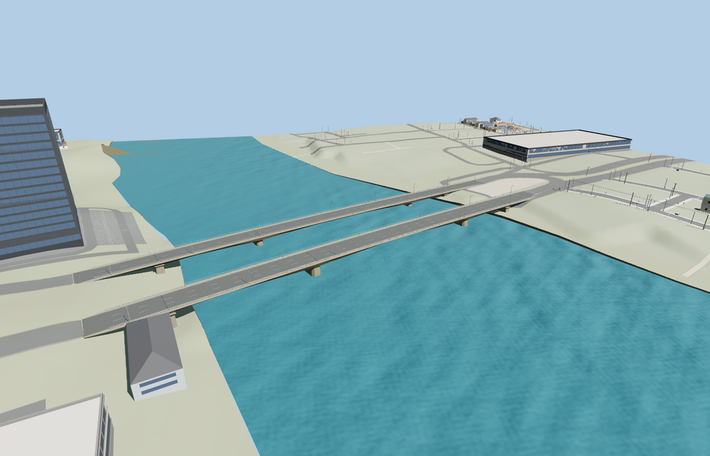

# Monivong Bridge, Phnom Penh

The north and south decks follow their separately mapped axes and match their four distinct landings. Each deck has three open spans, two river piers, two bank supports, variable-depth concrete girders, pedestrian walks and curved lamps.

The editable assembly rebuilds a 12,358-triangle source master. Both decks stream four levels. The combined skyline and district GLBs total 410,308 bytes. Thirteen GLBs passed validation with zero errors, warnings or embedded images. Both decks reuse the same three material graphs.

All four levels passed 12 road join checks, 16 approach checks, 44 deck-height checks, eight support contacts, six water-clearance checks and three probes in the open space between the decks. Maximum model-to-road height difference was 0.023 m in the sampled scene. The model replaces only the two original bridge segments. The viewer retains 141 other road records, 99 buildings, original terrain and water. A failed asset load preserves both mapped road segments. Unloading releases all model and support geometry.

Inspected 24 native views and 16 standalone views. Exterior details come from ordinary photographs. PMTiles sets the two deck axes and roadway ties. Standard Terrarium terrain sets the native ground fit. Widths, grades, river level and submerged foundation shapes are visualization approximations. The fixture uses reduced resolution and disabled shadows for Economy views. Physical-device timings remain unmeasured.

Rebuild both members and the assembly with `node packages/worldgen/scripts/generate-monivong-bridge.mjs`. Append `--check` to compare the generated source bytes.
