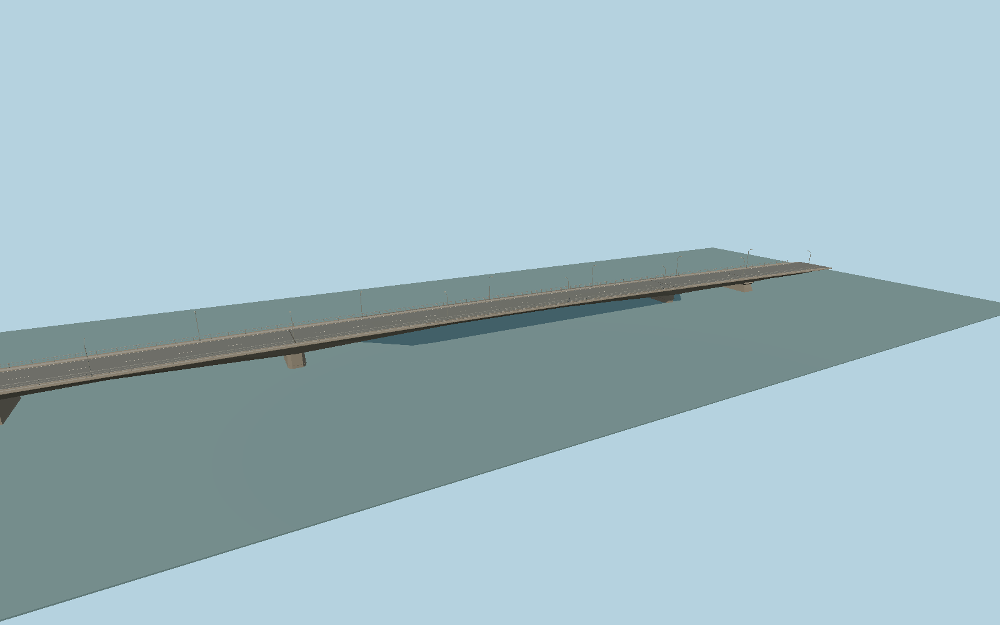

# Monivong Bridge north deck

The narrower north deck has two river piers, three open spans, deepened concrete haunches, pedestrian walks and tall curved lighting poles.

Rebuild: `node packages/worldgen/scripts/generate-monivong-bridge.mjs`;append `--check` for exact source bytes. Select import/LOD/placement with `--ids=monivong_bridge`. Detailed source and four browser tiers are separate ignored GLB outputs.

Each span follows its own PMTiles centerline and the paired landings. The northern and southern labels identify positions.

Cross sections, pier stations, parapets, and lighting are reconstructed from photos. The elevations fit standard viewer terrain and represent visual geometry.

The model includes both Monivong River decks. The surrounding roads, ramps and Bassac river remain native viewer data.

Original geometry follows the repository license. Map data is © OpenStreetMap contributors under ODbL-1.0 via Protomaps. The paired assembly carries the retained terrain and map inputs. Current acceptance is recorded in qa.json.
