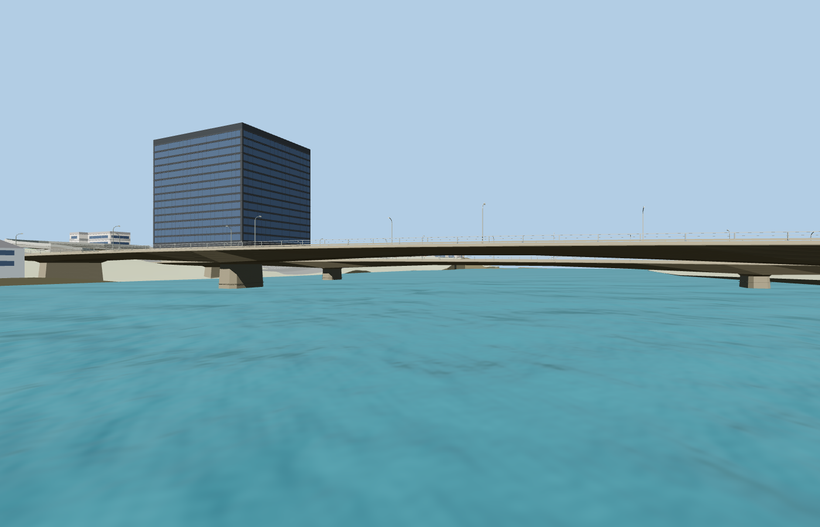

# Monivong Bridge south deck

The wider south deck has two broad river piers, three open spans, independent shore seats, raised walks and paired girder haunches. Exterior details come from ordinary photographs. PMTiles sets the two deck axes and roadway ties. Standard Terrarium terrain sets the native ground fit. Widths, grades, river level and submerged foundation shapes are visualization approximations. The fixture uses reduced resolution and disabled shadows for Economy views. Physical-device timings remain unmeasured.

All four browser levels use the independently mapped deck axis and landings. Six GLBs passed glTF validation and eight standalone views were inspected. See the [paired crossing review](../monivong_bridge/QA-REVIEW.md) for the native fit, load and eviction checks.
