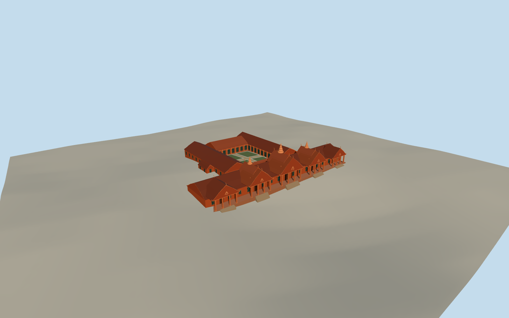

# National Museum of Cambodia

George Groslier’s National Museum of Cambodia in Phnom Penh, with five small and principal colonnaded roof pavilions, terracotta Khmer gables, and four galleries surrounding an open court.

Authoring state: **review-in-qa.json**. Current completion evidence is in [qa.json](qa.json) and the [completion ledger](../../../../qualla-structures/batches/qualla-003.PROGRESS.md).

- [National Museum of Cambodia](https://qualla.com/national-museum-of-cambodia/)

Native map lines control the footprint and courtyard void. The roof heights, veranda depths, court plantings and historical roof fittings are interpreted from the archive silhouette and the written conservation description.

The model depicts the standing building with its original exterior composition and 1924 wings. Interior volumes, the underground store and adjoining university buildings are outside the model scope.

Terracotta and related tones are approximate. Medium-fi geometric relief represents carved gables and gilded or dark ridge details.

The independently sampled elevation is retained in the review. Higher present-day DEM returns beside the western galleries may include buildings and trees, and obscure the lowest wall courses locally.

Build: `node content/worldgen/source/places/w6/w64/national_museum_of_cambodia/models/generate-national-museum-of-cambodia.mjs`. Add `--check` to verify exact regeneration. 7886 triangles; 6 materials; no embedded photographs.
