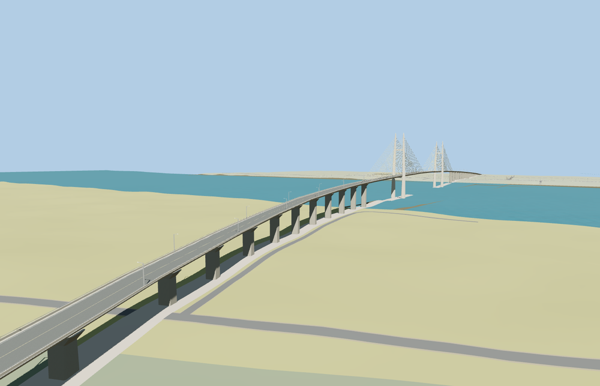

# Neak Loeung Bridge

Two open concrete pylons with pointed tips and yellow stay fans stand above the Mekong. A long western curve climbs to the straight crossing and continues onto the Prey Veng approach. The two-lane deck has a yellow center line, concrete parapets and single-arm lights.

The NH1 trace and OSM bridge way 1516178995 place the model from Kandal toward Prey Veng. The western curve follows the mapped approach and both bearings meet the retained roadway. Six seam samples pass per tier with a maximum height difference of 3.2 cm. Both local roads remain open beneath the approach viaducts. The original crossing returns when the model fails to load. Native terrain, water, approach ramps and lower paths remain.

The 38,896-triangle source rebuilds byte for byte. The first two runtime tiers total 347,556 bytes. Six GLBs validated and 38 current views were inspected.

The mapped NH1 trace fixes the curve, bearing positions, and orientation. The pylon dimensions, deck elevations, and approach pier stations are estimates based on exterior photographs and the standard elevation surface. The host water level and terrain resolution can vary.

Rebuild with `node packages/worldgen/scripts/generate-neak-loeung-bridge.mjs`. Append `--check` to compare exact bytes. Use `--ids=neak_loeung_bridge` for targeted import, LOD, placement and readiness.
