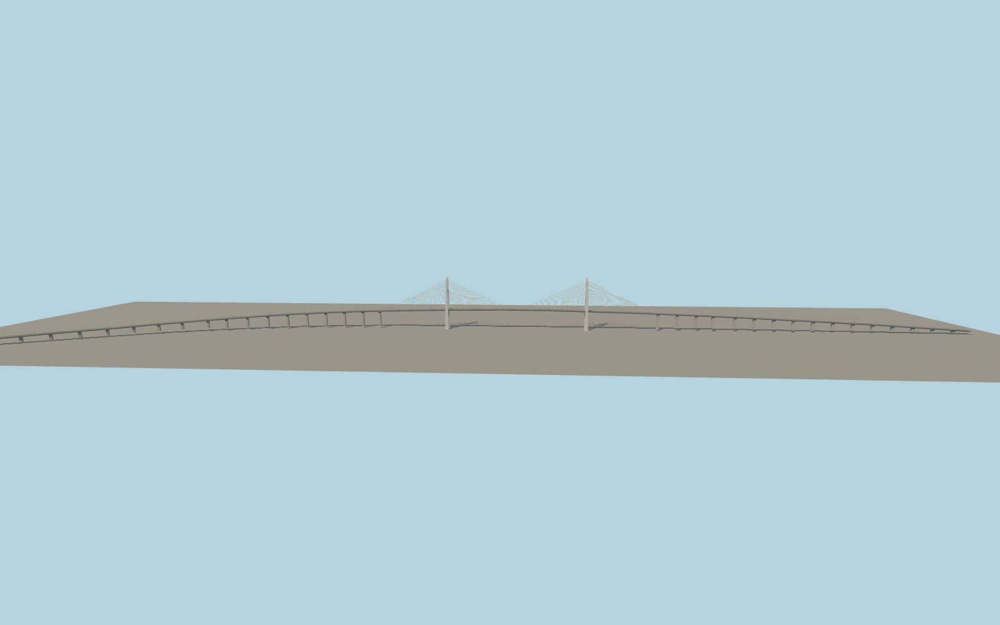

# Neak Loeung Bridge

Two open concrete pylons with pointed tips and yellow stay fans stand above the Mekong. A long western curve climbs to the straight crossing and continues onto the Prey Veng approach. The two-lane deck has a yellow center line, concrete parapets and single-arm lights.

Run `node packages/worldgen/scripts/generate-neak-loeung-bridge.mjs` to rebuild the source master. Append `--check` to compare the exact bytes. Use `--ids=neak_loeung_bridge` for targeted import, LOD generation and placement.

The mapped NH1 trace fixes the curve, bearing positions, and orientation. The pylon dimensions, deck elevations, and approach pier stations are estimates based on exterior photographs and the standard elevation surface.

The host water level and terrain resolution can vary.

Original geometry follows the repository license. Map data is © OpenStreetMap contributors under ODbL-1.0 via Protomaps. Terrain samples are described in terrain-grid.json. Ordinary pictures stay local and are not redistributed or used as textures. Current acceptance is recorded in qa.json.
