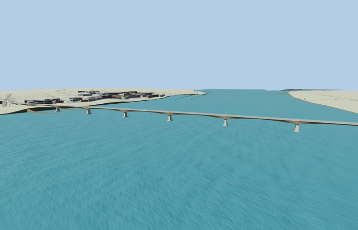

# Kizuna Bridge

Reviewed 2026-10-27. **Scoped complete concrete crossing and western elevated approach exterior with approximate native placement complete.**

Inspected62 current frames:11 portable,11 shared-material/geographic,23 medium-fi and17 native. Full western bend and crossing, continuous box-girder body, deep repeated pier haunches/shallow midspans, single tapered wall piers, broad rounded pile caps/piles, pale open concrete railings, raised edge walks and two-way road are present. Corrected the curved landing apron edge, preserved shallow midspan control points and raised the short western approach by1.56219m above the original coarse terrain bump in this same pass. Whole-scale turntables and generic context cameras have limited detail readability; dedicated haunch, pier, underside, driver and native views provide detail inspection.

Two existing shared256px graphs concrete_plain and metal_painted, metric UVs and linear tints. Concrete/road groups share one graph; district/street use two draws and one graph, close/master add the metal detail group/graph, and skyline uses one mean-tinted group. No private/embedded images or photograph pixels. Each required graph is fetched once in native views. Runtime uses four separate GPU attribute streams.

| Level | Triangles | Bytes | Draws |
| --- | ---: | ---: | ---: |
| skyline | 688 | 45960 | 1 |
| district | 3568 | 285596 | 2 |
| street | 9384 | 789564 | 2 |
| closeup | 23584 | 2054404 | 3 |

Master 28296 triangles / 3397972 bytes. Runtime 688 / 3568 / 9384 / 23584 triangles; 45960 / 285596 / 789564 / 2054404 bytes; 1 / 2 / 2 / 3 draws. Initial skyline plus district 331556 bytes. Strict medium-fi budgets pass; physical-device timings are unmeasured.

Exact-QID OSM way303560657/Q3396600 retains the named curved main axis; current PMTiles35184675649489 and directly connected elevated NR7 approach35184395998126 establish the full authored route. Anchor [105.469988177,11.985278818], heading-0.131640809967: +X east-southeast/Tonle Bet, -X west-northwest/Kampong Cham; +Z south-southwest/downstream. The mapped43.093m breadth reflects curvature, not physical deck width. Nominal13.5m width,17 supports and120m river-pier rhythm are photo-led approximations. Authored1557.742m x extent includes the connected approach rather than rescaling to the1436.474m named-way rectangle or older1500m fact. All6 actual mapped road-width joins have paving/model support within 0.003999710083235186m per LOD. Fifty actual native western road-width samples retain at least0.482346m over raw ground at every LOD; the source grade adjustment also uses300 denser standard-DEM samples. This is approximate viewer fit, not surveyed sections or legal navigation clearance.

All100 fixture buildings and135 independent road records remain. Successful replacement removes4 fully replaced elevated-road fragments from170 input records, leaving166; failure retains all170. Raw road inputs, DEM, displayed ground and water remain unchanged; connected main landing paving is deliberately graded. Failed loading keeps original map features; unload releases all model/support geometry. No ground/building cutout is used.

## Reconstruction limits

- Complete mapped main bridge plus directly connected elevated western approach, retaining the western bend. The1557.742m authored x extent differs from the1436.474m named-way rectangle and older1500m fact because the connected approach is included. The43.093m named-plan breadth is curvature; nominal13.5m physical width is a photo-led approximation.
- Ten river-pier stations spaced near120m, seven approach supports, box haunch depth2–6.5m, stem taper, pile-cap/pile sections, railing count and small fixtures are visual reconstruction controls, not surveyed structural dimensions. Main piers and caps are individually positioned along the measured centerline. Source master retains full support/railing/detail rhythm.
- Source origin6m; the main deck rises to roughly27m above sea level, with separate bank approach grades. Landings clear the maximum sampled standard Mapzen ground across the current12m default road ribbon. Native water, banks, raw roads and surrounding buildings remain unchanged. No surveyed or legal navigation/road clearance is claimed.
- Existing shared256px concrete_plain and metal_painted graphs, metric UVs and linear tints; no private/embedded images or photo pixels. Near concrete/road groups share one graph, while close detail adds the metal graph. Far LOD simplifies the underside to a uniform-depth silhouette and omits piles/railing bars; district/street retain real haunch rhythm with fewer railing posts/details.
- Photos guide the continuous box-girder exterior, not interior reinforcement, drainage hydraulics, exact bearing sections, plaque text, shoreline retaining geometry or vegetation. No unsupported lighting/cable-pylon features are added. Physical laptop/phone timings remain unmeasured.
- The native main river stage is about7.70m. Piles and lower footing faces are partly submerged, and some bank-side supports embed in coarse terrain. Exact surveyed sections, high/low-water clearances and approach-retaining geometry are not claimed.
- The western bank approach follows a coarse city DEM bump; a source-local1.56219m grade adjustment keeps the visible road above it while leaving ground/buildings intact. Native nearby poles, junctions, buildings and road crowns remain approximate context.
