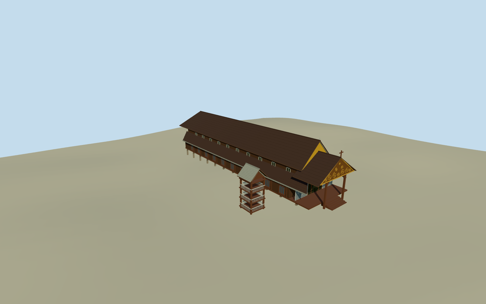

# St Michael's Church, Songyae

Long Thai timber church with a gold-carved porch, tiered shingle roof and a detached bell tower.

Authoring state: **review-in-qa.json**. Current completion evidence is in [qa.json](qa.json) and the [completion ledger](../../../../qualla-structures/batches/qualla-004.PROGRESS.md).

- [St Michael's Church, Songyae](https://qualla.com/st-michael-s-church-songyae/)

The roof and 2006 porch describe the standing church. Rear elevations and side windows remain representative estimates.

The detached bell tower is placed approximately from the original view. Individual carved scrolls and leaded-glass motifs are simplified.

The modern grounds, school and interior are outside scope.

Build: `node content/worldgen/source/places/w6/w6f/st_michael_s_church_songyae/models/generate-st-michael-s-church-songyae.mjs`. Add `--check` to verify exact regeneration. 9962 triangles; 6 materials; no embedded photographs.
