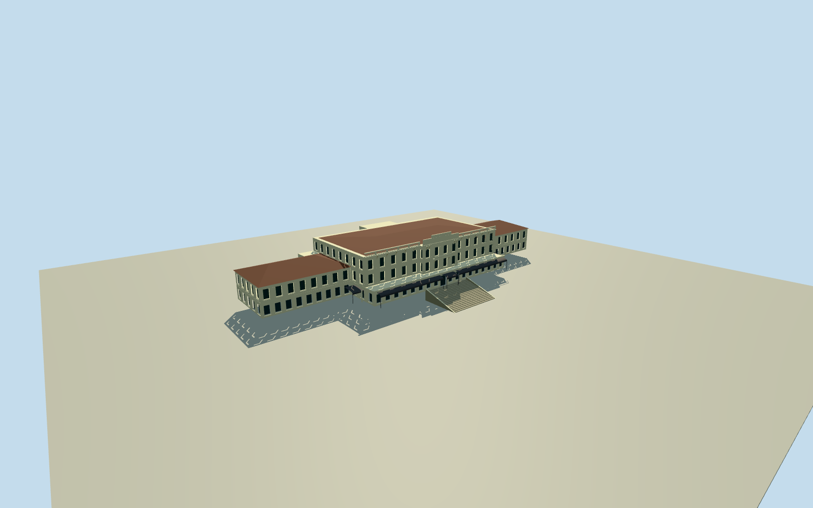

# Dalat Palace Hotel

Whole original mapped main building with native16control plan/signed bearing: cream stepped Art Deco front/crown, dark green shuttered physical windowrecesses, lower hipped-roof endwings, original rear projections, long bracketed cornices/central balcony, real open baluster parapets, glazed ground veranda/curved dark canopies and immediate stone entrance flight. Detached modern hotel/conference blocks/property grounds and interiors excluded; hidden elevations/sections/census bounded.

Authoring state: **review-in-qa.json**. Current completion evidence is in [qa.json](qa.json) and the [completion ledger](../../../../qualla-structures/batches/qualla-002.PROGRESS.md).

- [Dalat Palace Hotel](https://qualla.com/dalat-palace-hotel/)

All16 native main-building exterior controls retained without rectification in a signed frame derived from native long facade edge2-to3. +X toward southeast, +Z southwest; lake-facing facade is-Z, confirmed by native axial stair approach99661291 at x~0/z-38m. Native coordinate frame/whole footprint retained; no rectangular whole-property extrusion.

All floor/section/geometry choices made after immutable400m129x129 sourcefield freeze. Floor0 at fixed1507.9154m provider-relative SW datum, nofit/flatten/reacquire. Whole16control ground outline retained. Signed original bearing/front-Z fixed fromnativefacadeandaxialstairs. Original bounded photo-based estimates: central11.6m eave/12.6m openparapet/14.25m steppedcrown, lower7.7m endwings with2.4m hippedroof, ground3.8m veranda, upperfacade setbacks/projections, .28m windows/.42m closedentry physicalrecesses, immediateentry stair-2.6to0. Hiddenrearroof/room-windowcensus/bracketprofiles/louverpositions/condition/grade unsurveyed. Nativecontrols are plan evidence, not measuredheight/thresholds. Onlyoriginalmainbuilding; modernblocks/longgardenstairwalk excluded.

Five exact already-published2011Own/PD-self exterior originals by Diane Selwyn only.016 lacks bound local publicdomain basis and is unselected/not used; protected photos/interiors/former1920s facade/modern additions unselected. No copied image pixels/generated bitmap/article/media/rightsmetadata repair. Hidden rear elevations/roof stations/window census/baluster profiles/slat positions/finish are original bounded estimates. No garden/road/site plate/long axial stairwalk/trees/car/people/interior/signage.

Independent400m129x129 field/16641values/one raw tile frozen before floor0 and all architecture. Fixed1507.9154m SW provider datum unchanged. Construction-grade foundation/threshold contact unsurveyed, geographic preview/replaceFootprint=false; no terrain fit/flatten/reacquire.

Build: `node content/worldgen/source/places/w6/w6j/dalat_palace_hotel/models/generate-dalat-palace-hotel.mjs`. Add `--check` to verify exact regeneration. 19896 triangles; 5 materials; no embedded photographs.
