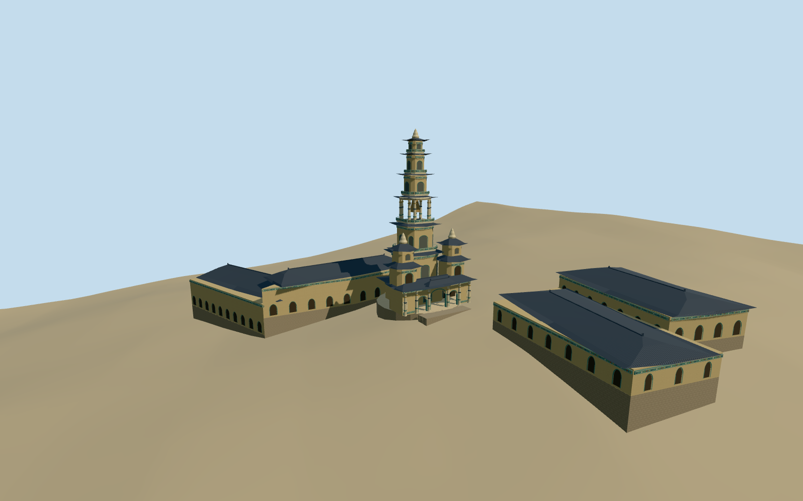

# Linh Phước Temple

Linh Phước Temple in Trại Mát. Dark blue upturned tile eaves, ceramic bands and relief-like color accents, a seven-tier bell tower, twin lower shrines, and attached temple ranges on the original steep terrain.

Authoring state: **review-in-qa.json**. Current completion evidence is in [qa.json](qa.json) and the [completion ledger](../../../../qualla-structures/batches/qualla-003.PROGRESS.md).

- [Linh Phước Temple](https://qualla.com/linh-phuoc-temple/)

The model includes the standing temple’s exterior volumes. Some courtyard, roof and window proportions and the exact massing of the adjacent ranges are approximate.

Ceramic materials, colors and trim are independently patterned. Distinctive figurative artwork, the bottle dragon sculpture, statuary, religious inscriptions and interiors are outside the model.

Build: `node content/worldgen/source/places/w6/w6j/linh_phuoc_temple/models/generate-linh-phuoc-temple.mjs`. Add `--check` to verify exact regeneration. 17706 triangles; 6 materials; no embedded photographs.
