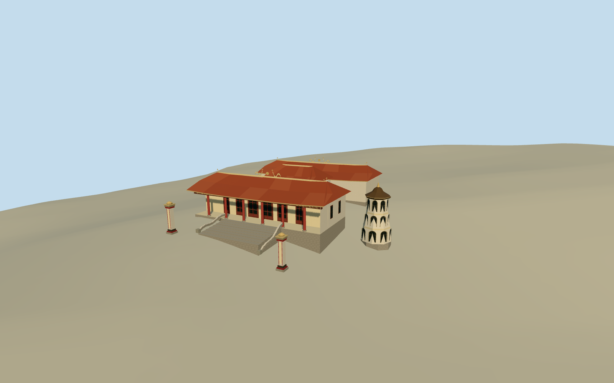

# Linh Sơn Temple

Đà Lạt’s Linh Sơn sanctuary with red-tiled interlocking halls, ridge dragons, paired entrance pillars and an octagonal tower.

Authoring state: **review-in-qa.json**. Current completion evidence is in [qa.json](qa.json) and the [completion ledger](../../../../qualla-structures/batches/qualla-003.PROGRESS.md).

- [Linh Sơn Temple](https://qualla.com/linh-son-temple/)

Main sanctuary extents align with the named OpenStreetMap building. The side tower and entrance columns have approximate positions and dimensions inferred from multiple ground photographs.

Rear doors, gold-painted ornament and dragon sculpture profiles are simplified. Parts beyond the central sanctuary, tower and principal access steps fall outside the modeled scope.

Build: `node content/worldgen/source/places/w6/w6j/linh_son_temple/models/generate-linh-son-temple.mjs`. Add `--check` to verify exact regeneration. 3578 triangles; 6 materials; no embedded photographs.
