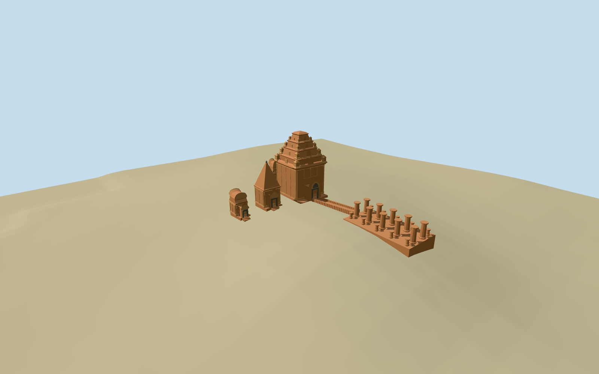

# Po Nagar

Specific Po Nagar standing complex: four mapped brick shrine envelopes with tall four-register main tower/miniature crowns, pointed south pyramid, smaller northwest stepped crown/saddle cap and low southeast saddle cap, projecting pointed entry porches/stone lintels/real recessed doors, original simplified relief/leaf/corner ornament and short local approaches. Mapped lower mandapa is an unroofed platform with approximate twenty octagonal tapered brick pillars and narrow grade-following approach steps. Existing shared brick/stone/dark-recess materials; no copied deity/story/text atlas, full ritual interior, vanished temple reconstruction or broad upper-court slab.

## Evidence and reconstruction

Published dimensions and reconstructed details are separated in spec.json. Primary references:

- [Reference](https://commons.wikimedia.org/wiki/File:Po_Nagar_Cham_Towers_façade_(14636082242).jpg)
- [Reference](https://commons.wikimedia.org/wiki/File:04052023_Ponagar_Hindu_temples_complex,_Nha_Trang_Vietnam_-_170.jpg)
- [Reference](https://commons.wikimedia.org/wiki/File:Ganesh_Tempel_Po_Nagar_Nha_Trang.jpg)
- [Reference](https://commons.wikimedia.org/wiki/File:04052023_Ponagar_Hindu_temples_complex,_Nha_Trang_Vietnam_-_184.jpg)
- [Reference](https://commons.wikimedia.org/wiki/File:04052023_Ponagar_Hindu_temples_complex,_Nha_Trang_Vietnam_-_257.jpg)

Deterministic specific Po Nagar complex from four mapped tower envelopes and the lower mandapa rectangle. Main four-register tower/miniature shrines, south pointed pyramid, distinct small northwest and southeast saddle caps, brick pilasters/pointed porches, stone entry lintels/real recessed doors and original simplified leaf/figure vocabulary. Unroofed twenty-pillar mandapa, local buried plinths and narrow native-grade approach. Three reused256-square graphs, metric UVs, linear tints and four browser levels; no embedded images or copied deity/text inventory.

## Model and axes

7,872 triangles; 23,616 vertices; 4 material groups; 947,588 bytes. Native bounds: -31.375, -3.839, -21.722 to 34.189, 22.805, 11.982. Source hash: `sha256:7b30cb9c19388271f2acc981825d084cba2ac104164b98804f71a424367f3fa4`.

{"x":"east","y":"up","z":"south"}

The geographic proposal uses exact-QID OpenStreetMap evidence. Map-derived orientation and estimated architectural details require real-site visual review; preview eligibility is distinct from geographic/fidelity approval. Map attribution: © OpenStreetMap contributors, ODbL-1.0.

## Reproduce

Run `node packages/worldgen/scripts/generate-additional-landmarks.mjs --ids=po_nagar` (or add `--check`). The generator preserves manually edited masters by checking their baseline hashes. Import through the standard authored-model workflow with optimization disabled; then capture all QA cameras, including shared-surface views.

## Pending work

- Specific Po Nagar standing complex: four mapped brick shrine envelopes with tall four-register main tower/miniature crowns, pointed south pyramid, smaller northwest stepped crown/saddle cap and low southeast saddle cap, projecting pointed entry porches/stone lintels/real recessed doors, original simplified relief/leaf/corner ornament and short local approaches. Mapped lower mandapa is an unroofed platform with approximate twenty octagonal tapered brick pillars and narrow grade-following approach steps. Existing shared brick/stone/dark-recess materials; no copied deity/story/text atlas, full ritual interior, vanished temple reconstruction or broad upper-court slab.
- Named standard PMTiles Po Nagar Cham Towers archaeological-site point35184518869179 correlates four tower buildings35184568984879..882 and lower mandapa rectangle35184568984883. No exact-QID building-footprint claim. Anchor109.19555556,12.26527778; heading0, internal local+x angle+.04rad; porches face approximately east/local+x. Actual mapped rectangles establish position and extent; body/porch subdivisions, miniatures, pillar stations and stair engineering are ordinary-picture/map approximations. Museum35184568984890 and all independent buildings remain native.
- Ordinary-picture/map visualization estimates, not surveys: main footprint about14.6x12.8m including east porch, tall main body11.2m/four receding upper registers to22.7m; south body6m/pointed roof-finial15m. Northwest small body4.5m, stepped upper block/corner crowns and saddle cap to10m; southeast low body4.1m/upper saddle cap to7.7m. Main porch about7.6m pointed crest, south porch crest about6.6m and smaller entry crests about5m. Lower mandapa approximately22.5x12m, twenty picture-led pillar stations with taller inner4.7m and lower outer2.0m shafts. Hidden allocations, exact relief inventory, repair patterns and absolute elevations approximate.
- Original standard6m Mapzen hill/city ground and water retained. Each tower and occupied mandapa platform has its own local level top with grade-buried bottom; short tower approaches and narrow connecting stair/cheeks follow the sampled coarse native grade. Open upper courts stay native ground. No broad hill/precinct slab, flattening or ground/water cutout. Coarse DEM does not resolve actual paved terraces, stair thresholds or cliff/retaining faces. Its retained mandapa maximum sample is slightly above the main-tower floor, so the narrow approach follows coarse native grade rather than recreating the photographed steep descent. This level relationship remains a terrain-resolution limitation.
- Hidden body/porch splits, miniature crown/relief inventory, exact masonry/repair positions, pillar counts/stations and thresholds are ordinary-picture/map approximations. Standard coarse terrain does not preserve the real steep terrace descent; the current approach follows sampled grade. No exact-QID footprint match, full ritual interior or copied deity/story/text atlas. Museum, independent buildings, upper courts, cliff/trees and water remain host context.

This bundle follows the medium-fi standard. Medium-fi appearance and geographic fit are reviewed separately. Hash-bound visual acceptance is recorded separately after capture inspection.

## Additional geographic data

©OpenStreetMap contributors; Protomaps; Mapzen/USGS terrain.
