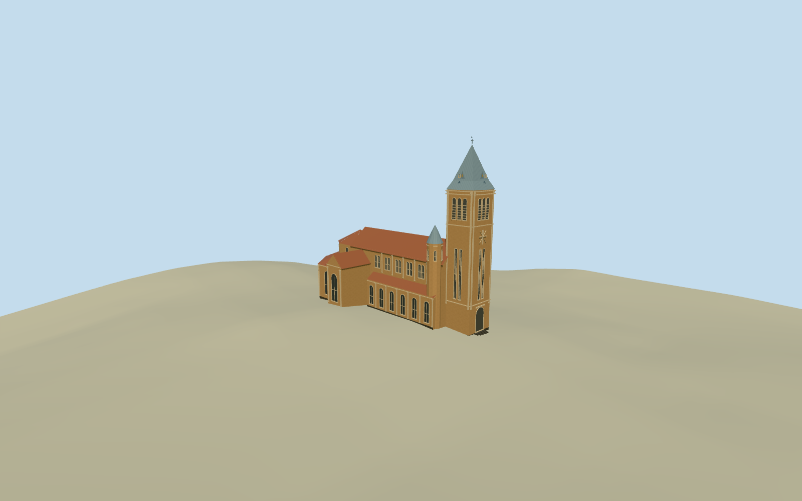

# St. Nicholas Cathedral, Da Lat

The ochre-and-cream St. Nicholas Cathedral of Da Lat, with the 47 metre bell tower, conical stair turrets, and stepped tile roofs.

Authoring state: **review-in-qa.json**. Current completion evidence is in [qa.json](qa.json) and the [completion ledger](../../../../qualla-structures/batches/qualla-004.PROGRESS.md).

- [St. Nicholas Cathedral, Da Lat](https://qualla.com/st-nicholas-cathedral-da-lat/)

Current cathedral building exterior. Separate support buildings and interiors lie outside scope.

The mapped outline controls the individual exterior footprint; heights other than the belfry and concealed details are estimates.

Build: `node content/worldgen/source/places/w6/w6j/st_nicholas_cathedral_da_lat/models/generate-st-nicholas-cathedral-da-lat.mjs`. Add `--check` to verify exact regeneration. 10735 triangles; 6 materials; no embedded photographs.
