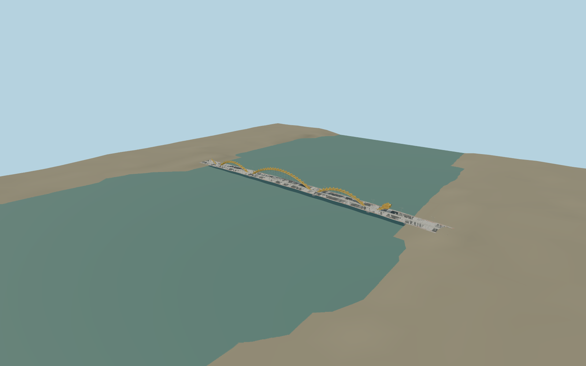

# Dragon Bridge, Da Nang

Compact original Dragon Bridge reconstruction: budgeted tubular arches, folded head/tail silhouette, hangers, lower concrete arches, roadway, sidewalks and sparse rails/lights. Original detailed master preserved independently.

## Evidence

- [Primary reference](https://www.wsp.com/en-us/projects/fire-breathing-dragon-bridge-vietnam)
- [Primary reference](https://www.asme.org/topics-resources/content/dragon-bridge-breathes-fire-into-economy)
- [Primary reference](https://doi.org/10.1051/e3sconf/20161000106)
- [Primary reference](https://www.e3s-conferences.org/articles/e3sconf/pdf/2016/05/e3sconf_seed2016_00106.pdf)
- [Primary reference](https://cttdt.danangportal.gov.vn/vi/w/cau-rong-bieu-tuong-kien-truc-moi-trong-thoi-ky-hoi-nhap-i)
- [Primary reference](https://www.openstreetmap.org/way/694831926)

Published dimensions and reconstruction assumptions are separated in spec.json. Source photos were consulted; no photos or third-party geometry are embedded. Map plan attribution: © OpenStreetMap contributors, ODbL-1.0.

## Source

54172 triangles; 6504572 bytes; 7 material groups. SHA256: sha256:d110464e83d269d2287402f92834213967c7262885b3b03c7687314ea51a8c4f.

Shared surfaces (concrete_plain, metal_painted, clay_fired, metal_stainless) are loaded through the central library; any transparent materials use local PBR parameters. Axis and provisional vertical datum are in spec.json.

Regenerate with node packages/worldgen/scripts/generate-researched-bridges.mjs --ids=dragon_river_bridge; append --check to verify. Import and capture through the standard structure-catalog scripts. Geometry validation does not substitute for current-frame visual review.

## Reconstruction limits

- Inspected one elevated daytime picture: three yellow tube arches, folded scales, layered east-facing head, broad road deck and side promenades. Standard viewer PMTiles confirms the east/west crossing across Han River. Retain666m authored extent and the existing provisional38.3m westward origin correction; the coarse760.74m map polygon includes extra approaches and is not used to stretch the bridge. West/east PMTiles approaches4.0784/7.8028m give approximatebase-3.1216m and browser deck endpoints7.2/10.9244m; a5m rise between them is reconstructed. River surface0m and submerged pier bases are approximate. Exact tide, engineering vertical curve, terminal joins and head plate outlines remain unverified.
- Original detailed master remains independently reproducible. Medium-fi derivatives simplify individual tubes at skyline/district distance and omit bolts, dense rail infill, triple hanger rods and decorative light curls. Closer models retain five arch tubes and the layered reconstructed head; shared painted/stainless metal, concrete and fired clay are reused.
- Approximate geometry/color agreement from one picture and PMTiles is sufficient for this visualization scope; no bespoke survey or research campaign. Physical-device timings remain unmeasured.
