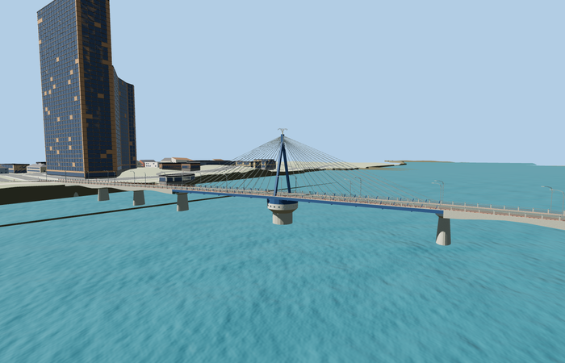
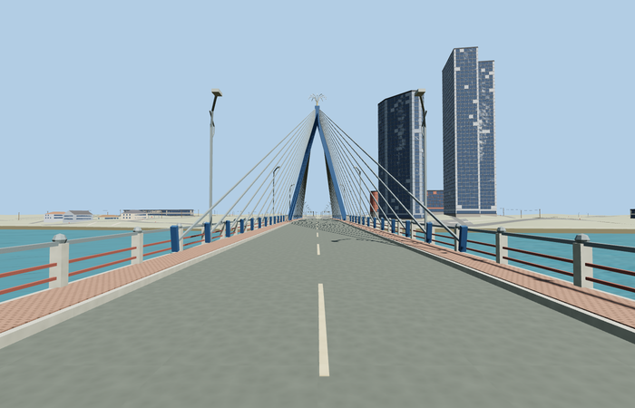

# Han River Bridge

Reviewed 2026-10-27. **Scoped closed-road/static swing-bridge exterior and approximate native placement complete.**

Inspected62 current frames:11 portable,11 shared-material/geographic,23 medium-fi and17 native. Complete closed-road crossing: blue A-frame and four stay-fan quadrants, pale flower crown, blue swing deck, round pivot drum with real portholes, haunched concrete approaches/green girders/rounded piers, brick walks, pale/red rails and crescent-arm lamps. Corrected short landing coverage/cross-slopes and missing skirt-panel corners during this same pass; all4062 geometry probes cover the final outputs. Full-scale turntables and the flat footprint-check image are thin; dedicated mast/driver/drum/approach/native cameras establish detail readability.

Three existing shared256px concrete_plain, metal_painted and brick graphs, metric UVs and linear vertex tints. Four semantic material groups share these three graphs; skyline is one untextured tinted group. No private/embedded images, downloaded meshes or copied photograph pixels. Each graph loads once per native scenario and all model/support geometry disposes.

| Level | Triangles | Bytes | Draws |
| --- | ---: | ---: | ---: |
| skyline | 652 | 56380 | 1 |
| district | 3868 | 291116 | 4 |
| street | 14240 | 1040868 | 4 |
| closeup | 44980 | 3682936 | 4 |

Master 58236 triangles / 6991248 bytes. Runtime triangles 652 / 3868 / 14240 / 44980, bytes 56380 / 291116 / 1040868 / 3682936, draws 1 / 4 / 4 / 4. Initial skyline plus district 347496 bytes. Actual1000/4000/16000/64000 triangle budgets pass; physical-device timings remain unmeasured.

Full494.584m named current PMTiles crossing35185068437310 plus northern sidewalk35185860725086; the catalog exact-QID way1164109461 covers only219m of its east side. Anchor[108.22713375091553,16.072193307553448], heading0.13557996741569242: +X east-northeast/Sơn Trà, -X west-southwest/Hải Châu, +Z south-southeast. No exact-QID full-current-way claim. The approximate catalog pivot is projected onto the road, discarding its15.267m lateral offset. Nominal487.7m extent,12.9m width,25m pylon rise and120m swing section retain their approximate scope. The source adds3m flared bank aprons rather than rescaling the crossing. At every LOD all18 actual apron-boundary samples have model support;15 paved samples meet within 0.00880774524739536m and three outer samples join unpaved ground. Fifteen mapped road/path width samples covered inside these source ramps establish coverage, not additional seam measurements.

All225 fixture buildings and73 independent road records remain. Successful replacement removes two fully replaced fragments from128 road records, leaving126; failure retains all128. Raw road inputs, DEM, displayed ground and water remain exact. Connected paving is deliberately graded and source-local short apron meshes fit its actual cross-slopes; no ground or building cutout is used. Failure preserves the original map and unload releases model/support geometry.

## Reconstruction limits

- Complete494.584m named PMTiles route; reference487.7m extent kept separate. Nominal12.9m width, photo-led25m pylon rise above the deck and120m swing section. Pivot x projects the approximate catalog coordinate onto the named road, discarding its15m cross-road offset. Support stations, mast/turntable dimensions, holes, fixtures and grades are reconstruction controls, not surveyed facts.
- Closed-road/static pose only. The swing span is identified by its blue A-frame, bilateral stay fans, blue edge girders, round white pivot drum with genuine porthole openings and a pale flower-like crown. No operating machinery or animated opening is claimed.
- Standard Mapzen bank heights are roughly10m west/6m east; the proposed road profile clears them without altering surrounding terrain. Native joins still require inspection.
- The source recreates the recognizable exterior rather than surveyed structural sections. Approach support count/stations, tapered pier sections, round pivot/porthole count, pylon height/station and span dimensions are photo-led approximations. The catalog25m height is not interpreted as a surveyed absolute elevation.
- Existing shared256px concrete_plain, metal_painted and brick graphs, metric UVs and linear vertex tints. No embedded/private images, copied photo pixels or downloaded meshes. Far geometry omits lamps/portholes and uses fewer cables/rounded segments; street/closeup retain genuine drum holes. Physical-device timings remain unmeasured.
- Main water is about0.65m in this native fixture; lower footings partly submerge and shore supports embed in coarse banks. Short apron grades, automatic retaining faces, native quays and neighboring procedural buildings remain visualization approximations. No surveyed bank, machinery, engineering clearance, legal traffic grade or animated swing operation is claimed.
