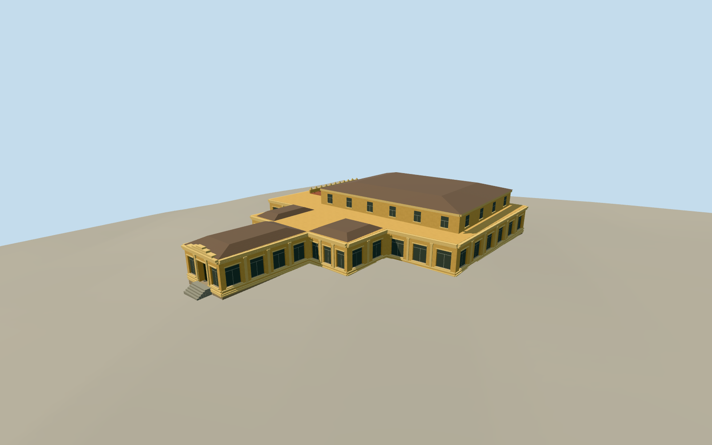

# Museum of Cham Sculpture, Da Nang

The ochre galleries of the Museum of Cham Sculpture in Da Nang, with its stepped entrance, Cham-inspired parapet and terracotta terrace.

Authoring state: **review-in-qa.json**. Current completion evidence is in [qa.json](qa.json) and the [completion ledger](../../../../qualla-structures/batches/qualla-003.PROGRESS.md).

- [Museum of Cham Sculpture](https://qualla.com/museum-of-cham-sculpture/)

Dated to the July 2014 terrace photograph, with the earlier public-domain entrance and courtyard photographs used for exterior forms visible before the 2016 renovation.

Roof spans and concealed slopes, terrace location, rear expansion elevations, exact openings, and thresholds are approximate. The roof is partly obscured in the accepted images.

The original elevation field is preserved. The terrain registration is an approximate visualization and the placement does not cover the surrounding museum grounds.

Build: `node content/worldgen/source/places/w6/w6u/museum_of_cham_sculpture/models/generate-museum.mjs`. Add `--check` to verify exact regeneration. 4788 triangles; 5 materials; no embedded photographs.
