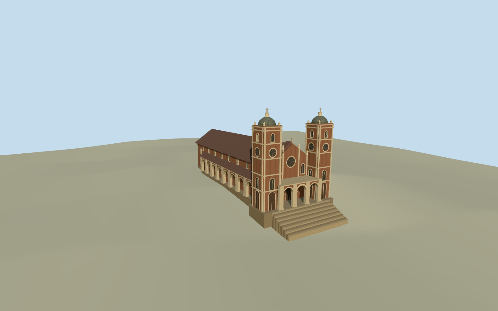

# Phủ Cam Cathedral

The 1902 Phủ Cam cathedral in 1908, with paired domed bell towers, a round central window, a long tile-roofed nave and open outer galleries.

Authoring state: **review-in-qa.json**. Current completion evidence is in [qa.json](qa.json) and the [completion ledger](../../../../qualla-structures/batches/qualla-004.PROGRESS.md).

- [Phủ Cam Cathedral](https://qualla.com/phu-cam-cathedral/)

The model depicts the demolished 1902 cathedral in the early Allys period. Its 1963 replacement has a different structure.

The exact historical foundation position, covered aisle spacing, external color, stair grade, roof transitions and apse are estimated.

Build: `node content/worldgen/source/places/w6/w6u/phu_cam_cathedral/models/generate-phu-cam-cathedral.mjs`. Add `--check` to verify exact regeneration. 9927 triangles; 6 materials; no embedded photographs.
