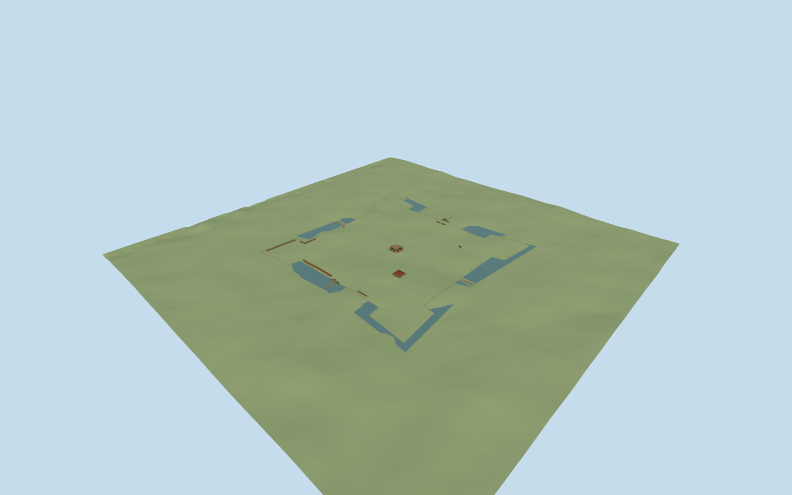

# Quảng Trị Citadel

The present Quảng Trị Citadel with its surviving gates, wall fragments, crossings, circular memorial and student monument.

Authoring state: **review-in-qa.json**. Current completion evidence is in [qa.json](qa.json) and the [completion ledger](../../../../qualla-structures/batches/qualla-003.PROGRESS.md).

- [Quảng Trị Citadel](https://qualla.com/quang-tri-citadel/)

The model represents the memorial site and surviving masonry. The vanished northwestern works and former grand gate towers at the east and west entries are outside the standing reconstruction.

The gate photo shows the site in 2012. Its event banner, flags and other temporary objects have been omitted from the structure.

Wall fragment heights, parapet details, the central lamp’s section, the small exhibition building’s elevations and the student memorial’s position inside the documented northeastern quadrant are estimated.

Build: `node content/worldgen/source/places/w6/w6u/quang_tri_citadel/models/generate-quang-tri-citadel.mjs`. Add `--check` to verify exact regeneration. 8624 triangles; 8 materials; no embedded photographs.
