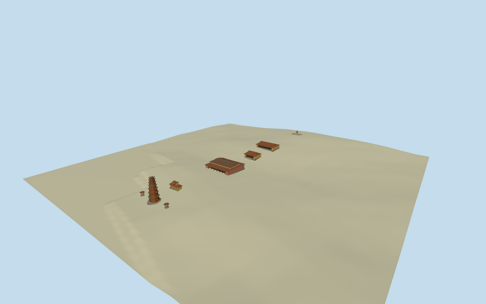

# Thiên Mụ Temple

Thiên Mụ’s seven-storey Phước Duyên Tower, Tam Quan gate, Đại Hùng worship hall and ridge-top axial compound.

Authoring state: **review-in-qa.json**. Current completion evidence is in [qa.json](qa.json) and the [completion ledger](../../../../qualla-structures/batches/qualla-004.PROGRESS.md).

- [Thiên Mụ Temple](https://qualla.com/thien-mu-temple/)

Tower height and building plan are documented. Section heights of the roofed halls, eave ornaments and the smaller pavilion details are estimated.

Build: `node content/worldgen/source/places/w6/w6u/thien_mu_temple/models/generate-thien-mu-temple.mjs`. Add `--check` to verify exact regeneration. 23480 triangles; 7 materials; no embedded photographs.
