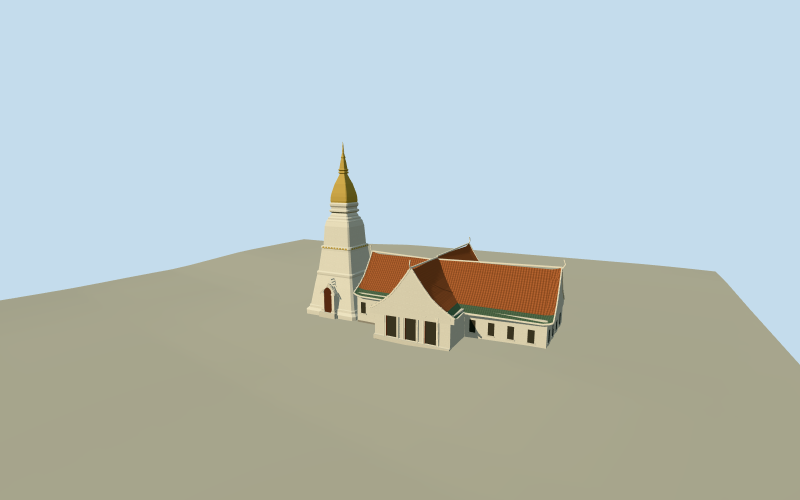

# Wat Phra That Choeng Chum

The square, white Lan Xang stupa with its gilt spire and the orange-and-green roof of the adjoining viharn in Sakon Nakhon.

Authoring state: **review-in-qa.json**. Current completion evidence is in [qa.json](qa.json) and the [completion ledger](../../../../qualla-structures/batches/qualla-004.PROGRESS.md).

- [Wat Phra That Choeng Chum](https://qualla.com/wat-phra-that-choeng-chum/)

The exterior model covers the standing stupa and its photographed eastern viharn. The older separate ordination hall and wider compound are outside this asset scope.

The spire divisions, relief work and ceramic roof ornaments use photographic proportions.

Build: `node content/worldgen/source/places/w7/w74/wat_phra_that_choeng_chum/models/generate-wat-phra-that-choeng-chum.mjs`. Add `--check` to verify exact regeneration. 5329 triangles; 8 materials; no embedded photographs.
