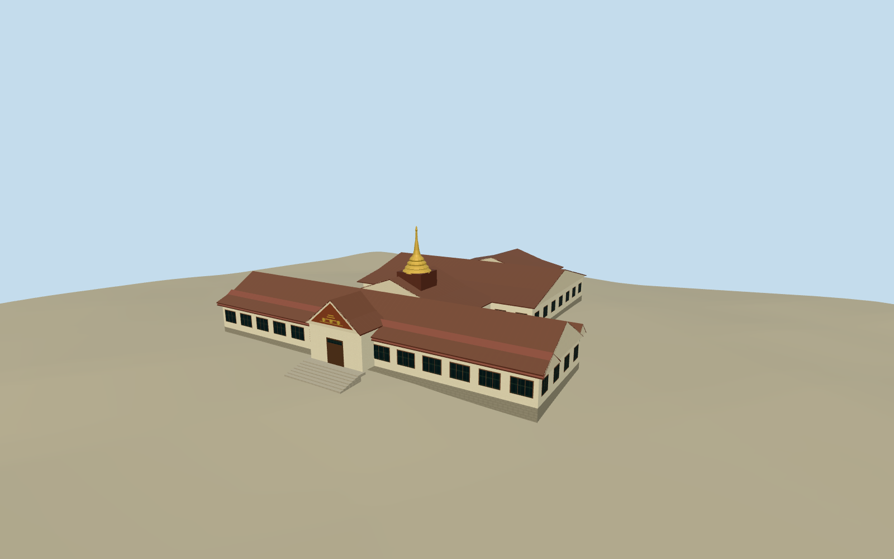

# Royal Palace, Luang Prabang

White Royal Palace with formally aligned windows, deep red tiled roofs, a central carved gable, broad marble stair and gold Lao throne-hall spire.

Authoring state: **review-in-qa.json**. Current completion evidence is in [qa.json](qa.json) and the [completion ledger](../../../../qualla-structures/batches/qualla-003.PROGRESS.md).

- [Royal Palace, Luang Prabang](https://qualla.com/royal-palace-luang-prabang/)

The native polygon controls the exterior footprint and its orientation. Small porch projections, roof and wall heights, rear window arrangement and small roof ornament need interpretation.

The bowed gable trim, royal emblem and gilded pinnacle will be modeled at exterior-view scale from the verified Qualla photo, with simplified ornamental relief.

The terrain review uses a 160 m crop from the original tile. A wider crop crossed invalid river-edge values outside the palace site. The palace threshold elevation is estimated.

Build: `node content/worldgen/source/places/w7/w78/royal_palace_luang_prabang/models/generate-royal-palace-luang-prabang.mjs`. Add `--check` to verify exact regeneration. 1631 triangles; 6 materials; no embedded photographs.
