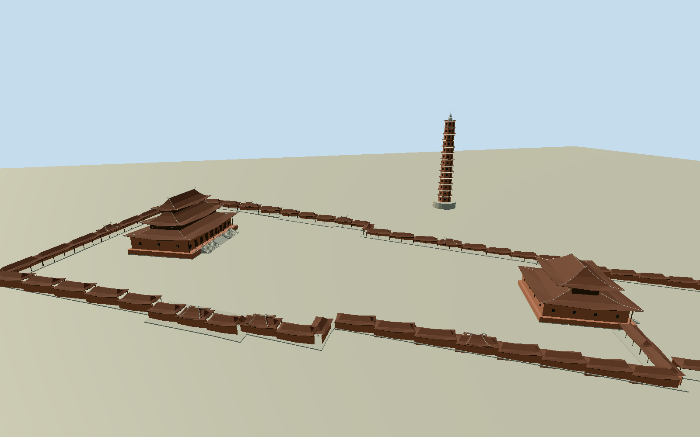

# Bái Đính Temple

Whole temple architectural ensemble: three large tiered-roof worship halls with recessed timber entrances/round windows/verandas/stone terraces, separate wooden inner and pale stone northern gateways with actual open passages, octagonal three-roof Bell Tower,13-storey100m Bao Thien stupa, small Tu An tower and complete native long stepped galleries/crossgable pavilions. Original small ancient mountain shrine exterior/portal estimates at separately identified native points retain the old part of the site without pretending surveyed plans. Natural mountain/caves, courts/ponds/gardens/roads/parking/convention center/restaurants/neighbors/sculpture/interiors excluded.

Authoring state: **review-in-qa.json**. Current completion evidence is in [qa.json](qa.json) and the [completion ledger](../../../../qualla-structures/batches/qualla-002.PROGRESS.md).

- [Bái Đính Temple](https://qualla.com/bai-inh-temple/)

Q3360468/vi:Chùa Bái Đính identity matches native named119control compound way449263549 and five individually named main structures. Preserve all native building and gallery envelope controls independently; never extrude property boundary. Older mountain shrines have identified native points but no surveyed individual footprints; their original bounded exterior reconstruction/locations must be distinguished from exact mapped new halls.

All floor/architectural section choices follow original1600m513x513 independent field freeze. Fixed23.1041m provider-relative SW datum unchanged. Three main halls, wooden innerGate plus separate northern outer stone gateway, octagonal Bell Tower,13storey100m stupa, small Tu An tower, all native galleries and bounded original ancient shrine exteriors retained. Native148XZcontrols unchanged; property not extruded. Wooden innerGate identity reconciled to namedpoint5354281321/nativegallerycentralpavilion, despite outerway449263545 alt-name. Tam The official76m altitude/34m height and Bell18.25m/innerGate16.5m/stupa100m are textual controls; other elevations/hidden sections/ancient unmapped plans/ornament/opening census are original estimates. Ancient components have lower confidence, not photogrammetry. Geographic grade/footings/current finish unresolved, preview/replacementfalse; no fit/flatten/reacquire.

Thirteen independent2017 creatorPD-self/own exact exterior originals accepted after Qualla-first search. Published Qualla PD-labelled originals lack bound local basis and remain unselected; native original X21/X23 show interiors and are unselected. No source rightsmetadata repairs, copied pixels, generated bitmap, sculpture/statue/carved inscription copies or interiors. Ancient mountain shrine plans/roof and door forms are original lower-confidence textual/typological estimates at named native points; accepted exteriors do not certify those hidden components.

Original1600m513x513263169sample field/six raw tiles frozen before floors/sections/geometry. Fixed23.1041m provider-relative datum unchanged; primary official Tam The76m altitude is not a surveyed tie to Terrarium. Other floor/section/hidden elevation/currentfinish/census/crest/ridge estimates are not surveys. Field never fitted/flattened/reacquired; no whole-property slab. All geographic placement stays preview/replacementfalse pending foundations/grade. Review flat ground and procedural context are synthetic fixtures.

Build: `node content/worldgen/source/places/w7/w7e/bai_dinh_temple/models/generate-bai-dinh-temple.mjs`. Add `--check` to verify exact regeneration. 58466 triangles; 6 materials; no embedded photographs.
