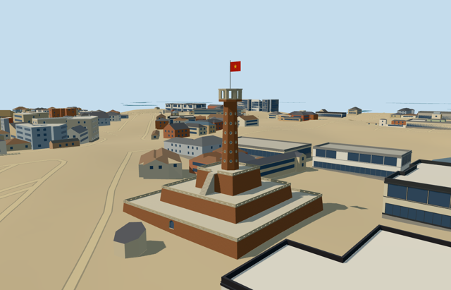

# flag_tower_of_hanoi — Flag Tower of Hanoi

Reviewed 2026-10-20 in one continuous author/build/inspect/fix round.

## Appearance

Inspected 47 current views during this construction pass. Three mapped battered brick terraces, pale pierced parapets and supported flights lead to a tapered octagonal shaft with real closed round recesses and simplified wheel-like spokes. The observation crown has eight genuinely open mouths, inward-facing reveals, a supported floor and a closed roof with renderable underside. The pole and geometric red flag/yellow star are visible from both sides. The three setbacks, shaft, crown and flag retain the photographed identity. Fine masonry aging and inscriptions are deliberately omitted rather than copied.

## Shared materials and browser levels

Five existing shared 256-square graphs: brick, stucco, stone_limestone_raw, metal_painted and fabric_canvas, with at most five material draws. Shared renders show metric brick courses, quiet pale plaster/stone, dark recessed panels and cloth grain on the flag. Existing canvas is reused, with the star in vertex color; there is no unique image atlas or embedded image. Each graph is read once per loaded model, and eviction disposes model geometry. Canonical surface refs, source/runtime/four LOD hashes, separate LOD position/normal buffers and matching counted CPU/GPU bytes pass.

| Level | Triangles | Bytes | Draws |
| --- | ---: | ---: | ---: |
| skyline | 780 | 82004 | 1 |
| district | 3776 | 362796 | 5 |
| street | 12572 | 1222212 | 5 |
| closeup | 19760 | 1922932 | 5 |

Inspected 24 medium-fi views covering noon and late afternoon, economy/high, three distances, neutral silhouette, four matched LODs and transitions. Skyline retains three terraces, octagonal shaft, open crown and flag; nearer levels add rosettes, pierced parapets and denser treads. During construction district rail spacing and street bracing were reduced to meet budgets. Levels780/3776/12572/19760 triangles; skyline plus district444800 bytes, below phone3MB/laptop6MB targets. Physical phone and laptop timings remain pending.

## Approximate map fit

Retained exact-QID OSM way184959290 and corresponding native parent35184557048122, terrace parts35185232061469/470/471, crown35185232061472 and shaft35185465033114 fix the site and component outlines. Anchor105.839823532,21.032590491/global heading0; internal first-terrace-edge axes and mapped octagonal phase. Only those six generic representations are removed, with zero residual. All1088 independent buildings among1094 resident originals are unchanged (3258 building records in the wider extract). Original6m ground/native path inputs and50141.661518m2 native water remain unchanged. All four levels unload cleanly; failed loading restores all1094 originals. Stair/gate sides and fine facade allocation retain25degree/3m picture-led approximation, not a surveyed directed entrance.

## Limits

Original medium-fi geometry uses three ordinary2010/2017 pictures and standard PMTiles. Component heights3.1/6.8/11.9/30.1/33.4m are retained; Commons metadata distinguishes33.4m masonry from41m with the flag. Nominal walk decks2.4/6.1/11.2m, shaft taper, rosette/rail inventory, staircase arrangement, crown collars, static flag and foundations remain approximate. The cafe and trees obscure portions of the lowest wall. No copied text, weathering/photo atlas, hidden interior staircase, military exhibit, cafe, whole museum or broad precinct terrain platform is authored. Neighboring host buildings retain procedural appearance.

## Selected checks

Six Khronos files: zero errors/warnings.332 actual mesh/material/contact checks; 47 current inspected views. Scene validation/sim30 and strict selected medium-fi audit pass. Source/runtime/LOD hashes and material bindings verified.

Rebuild: node packages/worldgen/scripts/generate-additional-landmarks.mjs --ids=flag_tower_of_hanoi; node packages/worldgen/scripts/import-structure-models.mjs --ids=flag_tower_of_hanoi; node packages/tooling/scripts/generate-landmark-lods.mjs --ids=flag_tower_of_hanoi --force.

Source: sha256:4c0e32a5c2e2a542cf52589dc5fd6b65f056b8a0e71785b57aaea27cbb91f1fb

Runtime: sha256:6d36202f9efcd69a138724caee3d81658f43bbe5c67d8d58e2042fd4d6a7447b

Input: sha256:e686944fca5daca8e1c1397fc6d65a13aa190cdbafcc95ee561276e3e5101e9e

## Viewed ordinary pictures

https://commons.wikimedia.org/wiki/File:Flag_Tower_of_Hanoi,_1812_(1)_(37608539335).jpg — Richard Mortel; CC-BY-2.0. Viewed only; no pixels copied.

https://commons.wikimedia.org/wiki/File:Lascar_Flag_Tower_of_Hanoi_(4550324293).jpg — Jorge Láscar; CC-BY-2.0. Viewed only; no pixels copied.

https://commons.wikimedia.org/wiki/File:Flag_Tower_of_Hanoi,_1812_(4)_(24623083838).jpg — Richard Mortel; CC-BY-2.0. Viewed only; no pixels copied.
