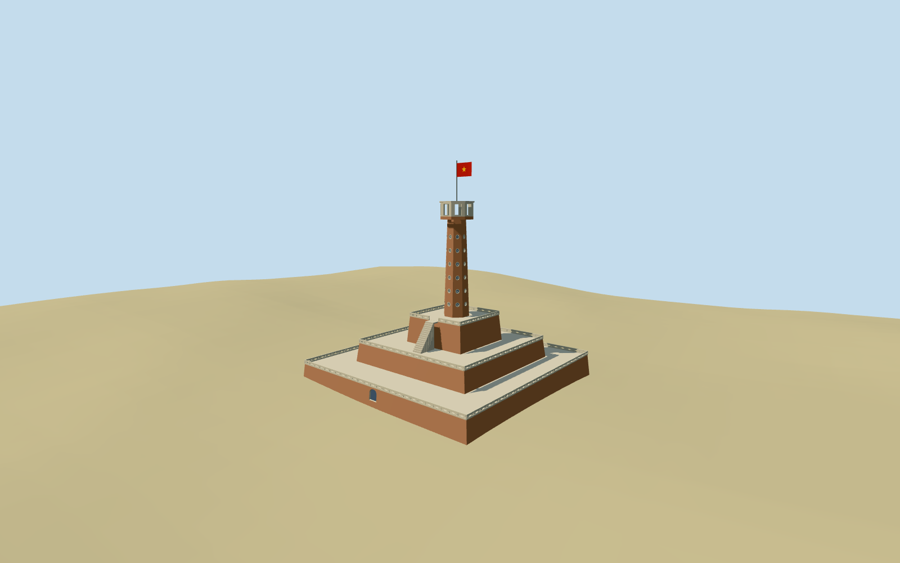

# Flag Tower of Hanoi

Specific Flag Tower of Hanoi: three mapped stepped battered brick terraces, pale pierced parapets/corner posts and bounded supported access flights, tapered octagonal brick shaft with round recessed rosette openings, genuinely open octagonal observation crown/closed roof lip, pole and double-sided red flag/yellow star. Five existing shared brick/stucco/limestone/painted-metal/canvas graphs. No copied inscription, weathering/photo atlas, interior staircase, cafe, military equipment, whole museum or adjacent monument.

## Evidence and reconstruction

Published dimensions and reconstructed details are separated in spec.json. Primary references:

- [Reference](https://commons.wikimedia.org/wiki/File:Flag_Tower_of_Hanoi,_1812_(1)_(37608539335).jpg)
- [Reference](https://commons.wikimedia.org/wiki/File:Lascar_Flag_Tower_of_Hanoi_(4550324293).jpg)
- [Reference](https://commons.wikimedia.org/wiki/File:Flag_Tower_of_Hanoi,_1812_(4)_(24623083838).jpg)

Specific Flag Tower of Hanoi: three mapped stepped battered brick terraces, pale pierced parapets/corner posts and bounded supported access flights, tapered octagonal brick shaft with round recessed rosette openings, genuinely open octagonal observation crown/closed roof lip, pole and double-sided red flag/yellow star. Five existing shared brick/stucco/limestone/painted-metal/canvas graphs. No copied inscription, weathering/photo atlas, interior staircase, cafe, military equipment, whole museum or adjacent monument.

## Model and axes

19,760 triangles; 59,280 vertices; 5 material groups; 2,374,592 bytes. Native bounds: -22.362, -1.848, -22.946 to 22.786, 41.541, 23.038. Source hash: `sha256:4c0e32a5c2e2a542cf52589dc5fd6b65f056b8a0e71785b57aaea27cbb91f1fb`.

{"x":"east","y":"up","z":"south"}

The geographic proposal uses exact-QID OpenStreetMap evidence. Map-derived orientation and estimated architectural details require real-site visual review; preview eligibility is distinct from geographic/fidelity approval. Map attribution: © OpenStreetMap contributors, ODbL-1.0.

## Reproduce

Run `node packages/worldgen/scripts/generate-additional-landmarks.mjs --ids=flag_tower_of_hanoi` (or add `--check`). The generator preserves manually edited masters by checking their baseline hashes. Import through the standard authored-model workflow with optimization disabled; then capture all QA cameras, including shared-surface views.

## Pending work

- Specific Flag Tower of Hanoi: three mapped stepped battered brick terraces, pale pierced parapets/corner posts and bounded supported access flights, tapered octagonal brick shaft with round recessed rosette openings, genuinely open octagonal observation crown/closed roof lip, pole and double-sided red flag/yellow star. Five existing shared brick/stucco/limestone/painted-metal/canvas graphs. No copied inscription, weathering/photo atlas, interior staircase, cafe, military equipment, whole museum or adjacent monument.
- Retained exact-QID OSM way184959290 and standard PMTiles parent35184557048122 with three terrace parts35185232061469/470/471, crown35185232061472 and shaft35185465033114 fix the compound, component outlines and undirected plan axes. Native anchor105.839823532,21.032590491; global heading0 with internal east/south rotation from the first mapped lower-terrace edge. Octagonal shaft/crown phases follow their mapped outlines. Fine gate/stair/facade allocation remains picture-led with25degree/3m uncertainty; no directed surveyed entrance is asserted.
- Mapped terrace tops3.1/6.8/11.9m and shaft30.1m/crown33.4m control height. Commons category distinguishes33.4m masonry from41m including flag; the retained41m fact alone is unqualified. Nominal walk floors2.4/6.1/11.2m reserve0.7m for parapets. Crown openings/roof collars, shaft taper, window/stair inventory, flag shape and footing remain picture/map visualization approximations.
- Keep original6m standard terrain, paths/water and every independent neighboring building. Replace only the six corresponding parent/terrace/shaft/crown shells. Lowest terrace footing straddles occupied native rim grades; higher terraces and access flights are supported by lower masonry. No ground/water cutout, square flattening or whole museum platform. Coarse terrain and vegetation-obscured pictures do not establish actual foundation engineering.
- Three useful ordinary2010/2017 photographs carried through construction. Fine rosette/parapet/stair details remain approximate; no copied inscription, unique photograph texture, furnished interior or whole museum.

This bundle follows the medium-fi standard. Medium-fi appearance and geographic fit are reviewed separately. Hash-bound visual acceptance is recorded separately after capture inspection.
