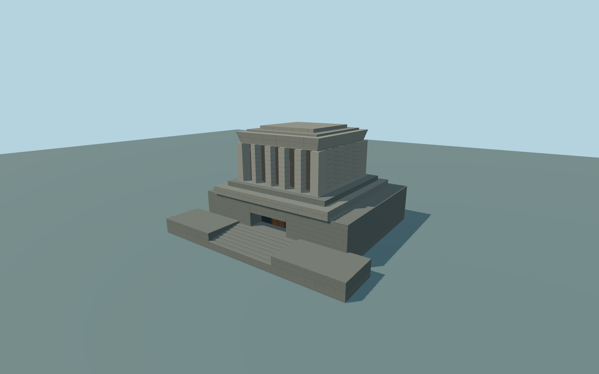

# Ho Chi Minh Mausoleum

Complete unique principal mausoleum exterior:T-shaped occupied stone podium withwider flanking terraces,eight central closed steps,deep rectangular entrance withclosed jambs/soffit/floor/backing andpaired paneled wooden door,broad coursed gray lower mass,three receding upper terraces,six front piers andfive deep reddish stone-backed recesses,connected side/rear pier rhythm,heavy flared frieze withclosed roof andsmall raised central roof. Original geometric stone courses anddoor panels;inscriptions,sculpture,guards,plants,ceremonial vessels andsite furniture are omitted. Independent parade viewing stands,gardens,square andnative neighbors arepreserved. No navigable orasserted funerary interior.

Rebuild: `node packages/worldgen/scripts/generate-ho-chi-minh-mausoleum.mjs`;append `--check` for exact source bytes. Select import/LOD/placement with `--ids=ho_chi_minh_mausoleum`. Detailed source and four browser tiers are separate ignored GLB outputs.

Complete unique principal mausoleum exterior:T-shaped occupied stone podium withwider flanking terraces,eight central closed steps,deep rectangular entrance withclosed jambs/soffit/floor/backing andpaired paneled wooden door,broad coursed gray lower mass,three receding upper terraces,six front piers andfive deep reddish stone-backed recesses,connected side/rear pier rhythm,heavy flared frieze withclosed roof andsmall raised central roof. Original geometric stone courses anddoor panels;inscriptions,sculpture,guards,plants,ceremonial vessels andsite furniture are omitted. Independent parade viewing stands,gardens,square andnative neighbors arepreserved. No navigable orasserted funerary interior.

Retained height21.6m/width41.2m andT-shaped41.351by36.345m footprint supplythe envelope. The parent7.8m tag is preserved and26 connected nativeparts supply terraces9.4/10.4m,piers18.25m,cap20.5m,roof20.9/21.6m,agreeing withretained height21.6m. Native pier plans guide all20 upper piers;these andthe2.6m entry floor,eight stairs,door/bay depths,hidden side/rear rhythm andstone panel inventory are ordinary-picture medium-fi proportions,not surveyed architectural dimensions. One host sample at the retained principal center givesY=0;standard field13.794426m. The fixture onlyrebases its vertical reference andpreserves raw heights/PNG. Exact thresholds andurban paving areoutside scope;native contact mustpass actual renders.

Two ordinary pictures actually inspected:one whole-front/slight-side andone tight entrance detail. The latter localfilename is misleading anddoes notshow the upper,side,rear orroof. Hidden rear/roof inventory,stone panel joints,wood panels andfacade proportions are original medium-fi approximations. No copied lettering/portraits/sculpture,no archival plans orbespoke surveys. Exact historic grades,numerical LOD errors andphysical-device timings remain unmeasured.

Two existing shared256px granite andplain-wood graphs in three material groups maximum. Metric UVs/linear colors andzero private orembedded images. Alltiers preserve thewhole T-shaped principal podium,closed central entrance/stair,three upper terraces,six front piers/five closed-backed recesses,side/rear returns,heavy closed cap andraised roof. Fine tiers add stone joints andwood panels. Detailed source retains finer coursing. Numeric LOD allowances are not measured surface errors.

Original geometry:repository license. Map:© OpenStreetMap contributors,ODbL-1.0;Protomaps. Standard terrain:terrain-grid.json. Ordinary pictures stay local and are not redistributed or used as textures. Current acceptance:qa.json.
