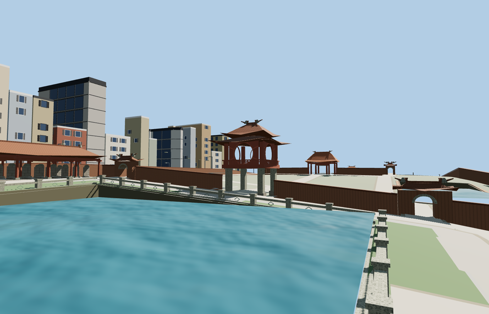

# Temple of Literature, Hanoi

Five open courtyards connect Văn Miếu’s main gate, the red Khuê Văn pavilion and Thiên Quang Well, the paired stele galleries, the ceremonial halls and Thái Học academy. Swept tile roofs, stone pillars, open passages and the well balustrade carry the site’s exterior character.

The 45,704-triangle source rebuilds byte for byte. Skyline, district, street and close-up use 988, 3,412, 12,144, 44,844 triangles. Skyline and district total 407,724 bytes. Six GLBs validated and 36 current views were inspected.

Five courtyard, five pool, five hall and five clear gate checks passed at every level. The Khuê Văn pavilion retains its open circular window. The model replaces 41 mapped site pieces while all 101 surrounding buildings and 107 road and path records stay in place. The original footprints return when the model fails to load.

The five-court exterior follows the PMTiles buildings, pools and paths. Eave profiles, wall heights and individual stele bases are photo-based reconstructions. The pavilions and approach thresholds fit the standard elevation samples. Water, planting and roads use host data. Roof ornament and inscription relief are represented at viewing scale. Interior shrines and legible inscriptions are outside this exterior model.

Rebuild with `node packages/worldgen/scripts/generate-temple-of-literature.mjs`. Append `--check` to compare exact bytes. Use `--ids=temple_of_literature` for targeted import, LOD, placement and readiness.
