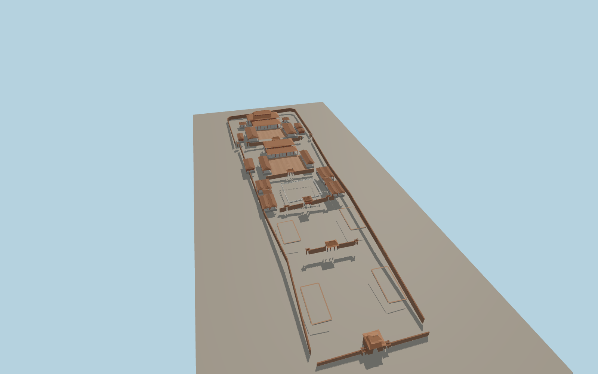

# Temple of Literature, Hanoi

Five open courtyards connect Văn Miếu’s main gate, the red Khuê Văn pavilion and Thiên Quang Well, the paired stele galleries, the ceremonial halls and Thái Học academy. Swept tile roofs, stone pillars, open passages and the well balustrade carry the site’s exterior character.

Run `node packages/worldgen/scripts/generate-temple-of-literature.mjs` to rebuild the source master. Append `--check` to compare the exact bytes. Use `--ids=temple_of_literature` for targeted import, LOD generation and placement.

The five-court exterior follows the PMTiles buildings, pools and paths. Eave profiles, wall heights and individual stele bases are photo-based reconstructions.

The pavilions and approach thresholds fit the standard elevation samples. Water, planting and roads use host data.

Roof ornament and inscription relief are represented at viewing scale. Interior shrines and legible inscriptions are outside this exterior model.

Original geometry follows the repository license. Map data is © OpenStreetMap contributors under ODbL-1.0 via Protomaps. Terrain samples are described in terrain-grid.json. Ordinary pictures stay local and are not redistributed or used as textures. Current acceptance is recorded in qa.json.
