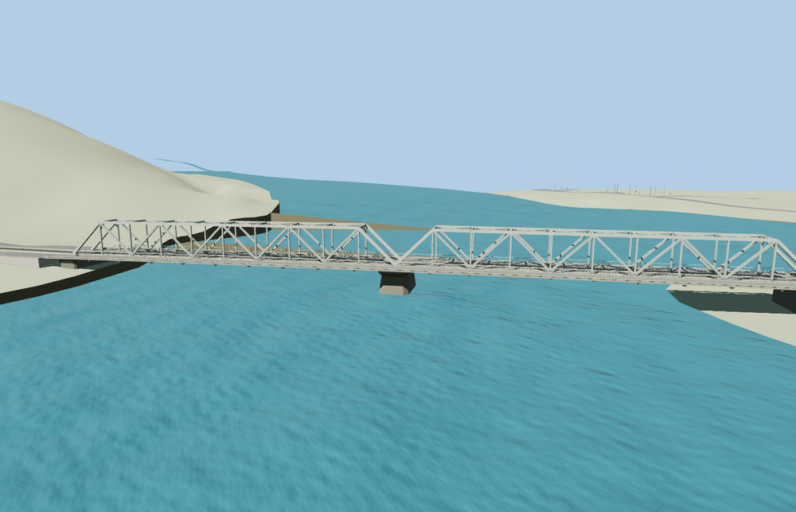

# Thanh Hoa Bridge

The rebuilt Hàm Rồng bridge crosses the Mã River in two gray steel through-truss spans. A single track runs inside the braced trusses, with separate cantilevered roadways, slender steel guardrails, and one central concrete river pier.

The named Cầu Hàm Rồng railway way 537517258 and the paired PMTiles roadway traces identify the rebuilt crossing associated with Q4346741. The bridge crosses the Mã River east-southeast. Its rail embankments meet the sampled ground on both banks, and the separate Hoàng Long bridge stays native. Eighteen landing probes per tier, six on the rail deck and twelve on the road decks, found a maximum height difference of 0.010 m. The four sampled points beneath the steel spans retained at least 5.88 m of viewer water clearance. The original rail and roadway bridge records return when the model fails to load. The native water, terrain and separate Hoàng Long crossing remain.

The 32,352-triangle source rebuilds byte for byte. The first two runtime tiers total 316,496 bytes. Six GLBs validated and 36 current views were inspected.

The source reproduces the rebuilt gray steel crossing visible in the exterior photographs. The truss dimensions, rail ties and surface details are photo-led approximations. The named rail way and paired roadway centerlines fix the signed alignment and extents. Standard terrain under-resolves the embankments and riverbed. Short modeled retaining approaches carry the narrow-gauge track to the sampled banks. Outside them, the viewer uses its generic rail ribbon and track spacing.

Rebuild with `node packages/worldgen/scripts/generate-vushtrri-stone-bridge.mjs`. Append `--check` to compare exact bytes. Use `--ids=vushtrri_stone_bridge` for targeted import, LOD, placement and readiness.
