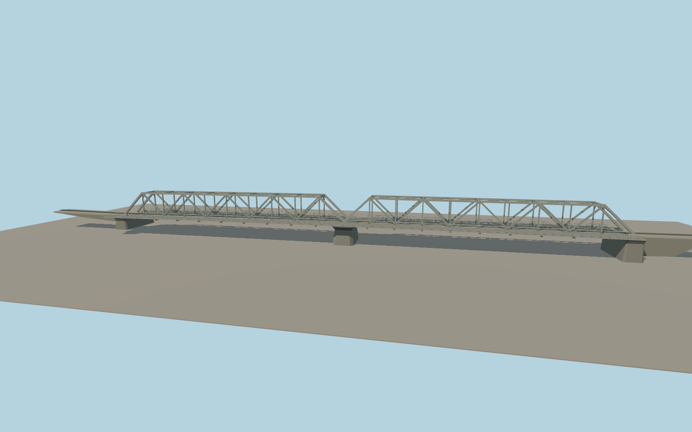

# Thanh Hoa Bridge

The rebuilt Hàm Rồng bridge crosses the Mã River in two gray steel through-truss spans. A single track runs inside the braced trusses, with separate cantilevered roadways, slender steel guardrails, and one central concrete river pier.

Run `node packages/worldgen/scripts/generate-thanh-hoa-bridge.mjs` to rebuild the source master. Append `--check` to compare the exact bytes. Use `--ids=thanh_hoa_bridge` for targeted import, LOD generation and placement.

The source reproduces the rebuilt gray steel crossing visible in the exterior photographs. The truss dimensions, rail ties and surface details are photo-led approximations.

The named rail way and paired roadway centerlines fix the signed alignment and extents. Standard terrain under-resolves the embankments and riverbed.

Short modeled retaining approaches carry the narrow-gauge track to the sampled banks. Outside them, the viewer uses its generic rail ribbon and track spacing.

Original geometry follows the repository license. Map data is © OpenStreetMap contributors under ODbL-1.0 via Protomaps. Terrain samples are described in terrain-grid.json. Ordinary pictures stay local and are not redistributed or used as textures. Current acceptance is recorded in qa.json.
