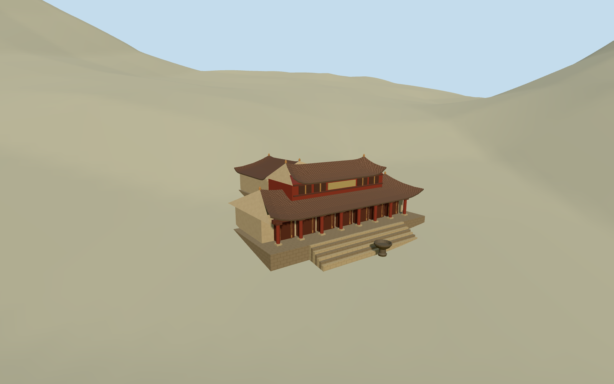

# Thiên Trù Pagoda

The Tam Bảo main sanctuary of Thiên Trù Pagoda with two upturned tile roofs, a red timber colonnade, raised plaque and bronze incense bowl.

Authoring state: **review-in-qa.json**. Current completion evidence is in [qa.json](qa.json) and the [completion ledger](../../../../qualla-structures/batches/qualla-004.PROGRESS.md).

- [Hương Temple](https://qualla.com/huong-temple/)

This placement is the main Tam Bảo hall. The surrounding entrance structures, ancillary shrines and caves are separate sites.

Rear subdivision, roof height, roof sculptures and the platform profile are approximate.

Build: `node content/worldgen/source/places/w7/w7e/thien_tru_pagoda/models/generate-thien-tru-pagoda.mjs`. Add `--check` to verify exact regeneration. 3008 triangles; 6 materials; no embedded photographs.
