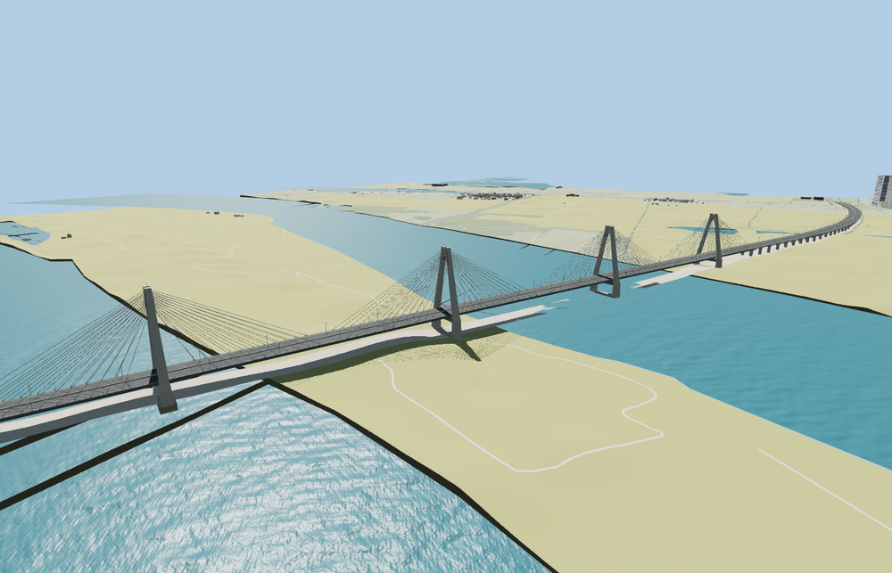

# Nhật Tân Bridge

Nhật Tân Bridge with five concrete A-frame towers, two planes of cable fans, the six-span Red River deck, curved approach viaducts, median, roadway markings and lamp standards.

The 57,330-triangle source rebuilds byte for byte. Skyline, district, street and close-up use 1,000, 3,862, 14,934, 45,666 triangles. The first two tiers total 371,912 bytes. Six GLBs validated and 38 current views were inspected.

All tiers retain the five open tower arches and align the deck across the native route. The viewer removes 22 redundant bridge road records, preserves all 329 buildings in the test tile and retains the independent cross streets and paths. The original road deck returns on failed loading.

PMTiles and the aerial photograph establish the curved approach alignment and five visible pylon stations. The replacement corridor follows the mapped car and motorcycle paths, which occasionally fall just outside the physical bridge outline. Exact pier and roadway fitting dimensions outside the main span are visually inferred. Pylon top elevations use the published tower-height pattern in an approximate sea-level frame. Standard Terrarium determines visible foundation contact and road joins. Bathymetry, engineering clearances and physical-device performance were not surveyed. Physical-device timings are unmeasured.

Rebuild with `node packages/worldgen/scripts/generate-nhat-tan-bridge.mjs`. Append `--check` to compare exact bytes. Use `--ids=nhat_tan_bridge` for targeted import, LOD, placement and readiness.
