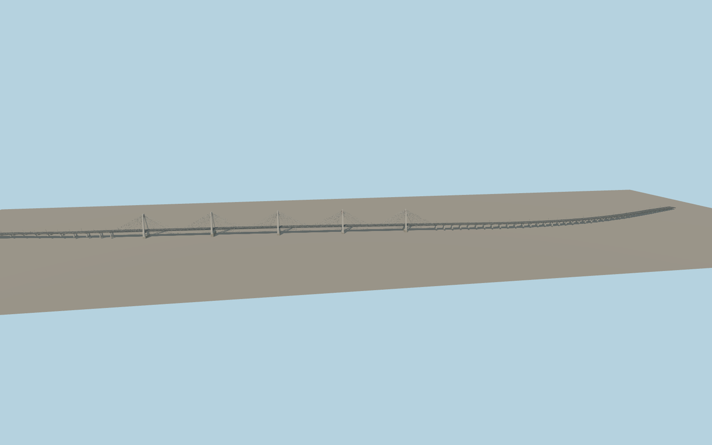

# Nhật Tân Bridge

Nhật Tân Bridge with five concrete A-frame towers, two planes of cable fans, the six-span Red River deck, curved approach viaducts, median, roadway markings and lamp standards.

Run `node packages/worldgen/scripts/generate-nhat-tan-bridge.mjs` to rebuild the source master. Append `--check` to compare the exact bytes. Use `--ids=nhat_tan_bridge` for targeted import, LOD generation and placement.

PMTiles and the aerial photograph establish the curved approach alignment and five visible pylon stations. The replacement corridor follows the mapped car and motorcycle paths, which occasionally fall just outside the physical bridge outline. Exact pier and roadway fitting dimensions outside the main span are visually inferred.

Pylon top elevations use the published tower-height pattern in an approximate sea-level frame. Standard Terrarium determines visible foundation contact and road joins. Bathymetry, engineering clearances and physical-device performance were not surveyed.

Original geometry follows the repository license. Map data is © OpenStreetMap contributors under ODbL-1.0 via Protomaps. Terrain samples are described in terrain-grid.json. Ordinary pictures stay local and are not redistributed or used as textures. Current acceptance is recorded in qa.json.
