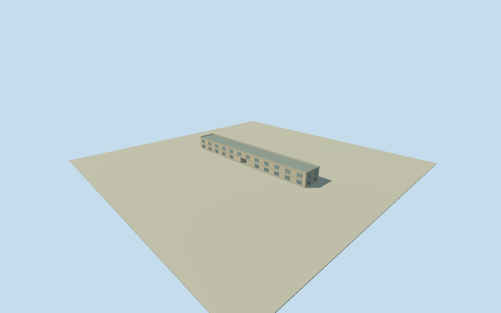

# Brunei Energy Hub — former Royal Customs House

Whole Brunei Energy Hub/former Royal Customs and Excise Building, approximate2023museum exterior: complete original four-control94.43m by12.48m long two-storey building, full flat roof/parapet, genuine central lower-storey vehicle passage, louvred window/door openings, original customs-house sign presence and external replica sign. Designer’s written reconstruction account and founding partner’s building identity bind physical scope; Qualla’s own written story supplies central passage. Native way is unnamed but exactly matches the long two-storey waterfront museum. Floor/height/storey divisions, parapet and opening profiles, bay/louvre/grille counts and materials/colours/sign lettering/grade are explicit estimates. Rounded120m/400-foot wharf-related length not substituted for native building geometry. Independent wharf/landscape/cafes/waterfront buildings/interiors/exhibits excluded. Every image/figure/video unused.

Authoring state: **review-in-qa.json**. Current completion evidence is in [qa.json](qa.json) and the [completion ledger](../../../../qualla-structures/batches/qualla-002.PROGRESS.md).

- [From Customs House to Energy Story](https://qualla.com/brunei-energy-hub/)

Whole Brunei Energy Hub/former Royal Customs and Excise Building, approximate2023museum exterior: complete original four-control94.43m by12.48m long two-storey building, full flat roof/parapet, genuine central lower-storey vehicle passage, louvred window/door openings, original customs-house sign presence and external replica sign. Designer’s written reconstruction account and founding partner’s building identity bind physical scope; Qualla’s own written story supplies central passage. Native way is unnamed but exactly matches the long two-storey waterfront museum. Floor/height/storey divisions, parapet and opening profiles, bay/louvre/grille counts and materials/colours/sign lettering/grade are explicit estimates. Rounded120m/400-foot wharf-related length not substituted for native building geometry. Independent wharf/landscape/cafes/waterfront buildings/interiors/exhibits excluded. Every image/figure/video unused.

Native whole four-control long building is about94.43x12.48m and explicitly tagged2storeys. Original corners retained; not stretched to narrative400ft/120m wharf-related dimensions. Native way has no name/QID; independent institutional identity/location matches the designer/partner and exact article. Primary designer specifies flat box form, preservedlouvres/originalsign and replica sign.

Vertical floor0.45m above original provider datum8.1167m,3.9m storeys, roof/parapet height, central5.4m-wide by3.6m-high open passage, bay positions/12bays-per-long-side census, louvre/grille sections, windows/door count, cornices, service details and restrained paint/low-E glazing appearance are bounded estimates. Designer notes limited original material/colour data; no known exact facade census or original1956materials claimed.

Central vehicle-passage presence is described by Qualla’s local user-owned written article; it is a genuine unobstructed through-opening in the lower storey. Exact portal frame, functional dimensions, depth lining, sign positioning and basic new procedural lettering are estimated. The preserved original sign’s presence is represented; replica text is plain geometric lettering, not copied historical typographic artwork. No interiors/exhibits/sign graphics/photos used.

Whole two-storey customs-house physical building and intrinsic flatroof/parapet/passage/windows/signage included. Separate concrete wharf, road/parking/waterfront paving/landscape/cafes/neighboring buildings, river/mosque/bridge and museum interiors excluded. Both full long facades and short ends retained, not a facade strip or part of the building.

Original independent256m/16641height field and single original tile precede all floor/main sections. Source includes low river DEM artifact down to-323.8295m, datum8.1167m, and coarse canopy/building offsets. Field/frame/floor/main sections remain immutable during review; no flattening/mask/cutout/refetch/refit. Geographic ground contact/vertical registration approximate and unverified; historical2023preview, not current-world replacement.

All imagery/video/figures unused after Qualla-first30family search. Primary designer account available as an actual cached web-search extract; original endpointHTTP404 is disclosed, not bypassed or claimedHTTP200. Founding-partner article directlyHTTP200 and Qualla local story text supply identity/passage facts. No image license or photographic fidelity approval.

Build: `node content/worldgen/source/places/w8/w8c/brunei_energy_hub/models/generate-house.mjs`. Add `--check` to verify exact regeneration. 11384 triangles; 6 materials; no embedded photographs.
