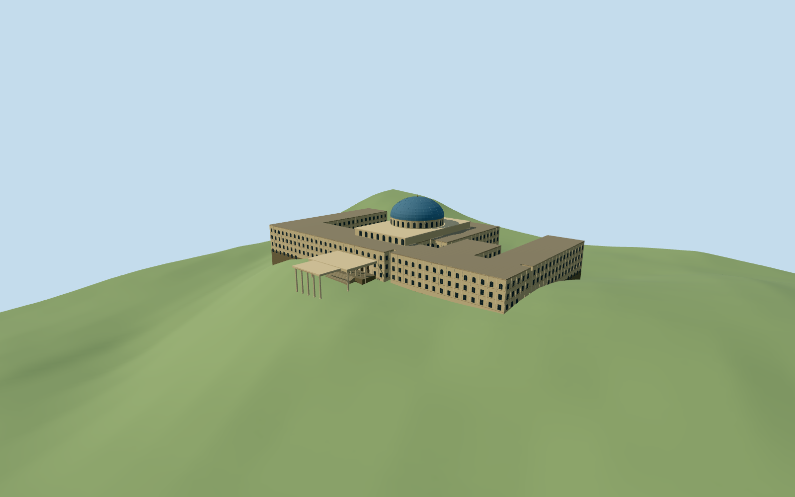

# Legislative Council Building, Brunei

Four-storey Legislative Council Building overlooking Bandar Seri Begawan, with a domed central chamber, two wings and a ceremonial drive under the columned portico.

Authoring state: **review-in-qa.json**. Current completion evidence is in [qa.json](qa.json) and the [completion ledger](../../../../qualla-structures/batches/qualla-003.PROGRESS.md).

- [The Parliament That Answers to One](https://qualla.com/legislative-council-of-brunei/)

The mapped perimeter and covered drive are direct geographic controls. Unmeasured upper heights, dome radius, roof subdivisions and façade spacing are approximate.

The façade finishes and woven motifs are simplified from published descriptions. The scope is the public exterior, including the ceremonial entrance and standing council wings.

The image in the story depicts the original council members in 1959, before construction of the present building. This reconstruction uses written architectural records and mapped shape.

Build: `node content/worldgen/source/places/w8/w8c/legislative_council_building_brunei/models/generate-legislative-council-building-brunei.mjs`. Add `--check` to verify exact regeneration. 21907 triangles; 6 materials; no embedded photographs.
