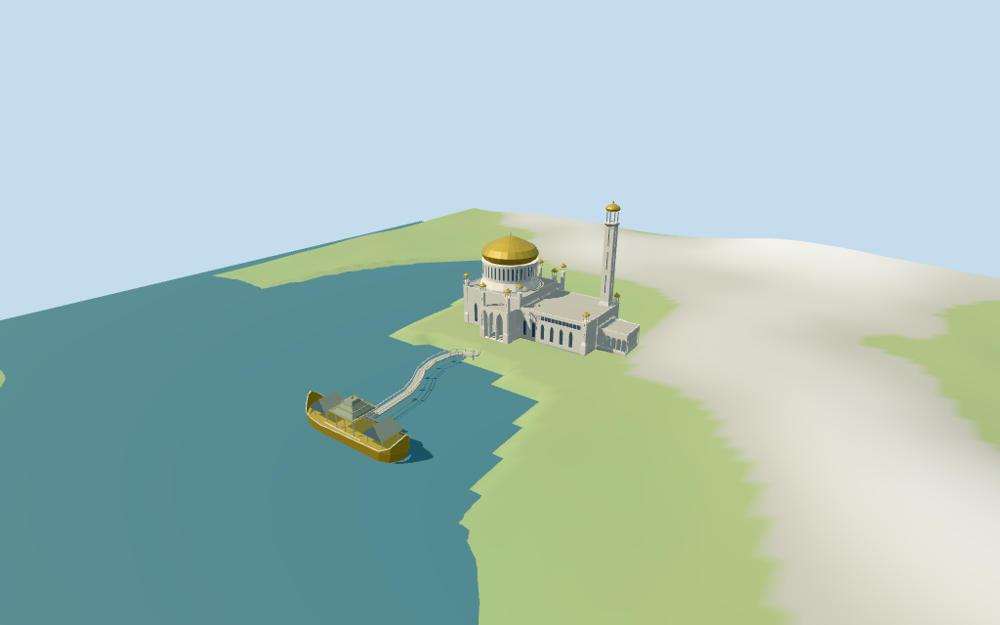

# N0451 — Omar Ali Saifuddien Mosque

Reviewed 2026-10-17 for the stated medium-fi exterior and approximate map fit. Heights, partitions, ornament, current finish and exact ground/water joins remain limited.

## Exterior and shared materials

Inspected all 11 final portable views, including the 1024×640 summary. The gold bulb dome over a slotted white drum, tall square minaret with an open crown, gold-capped corner chattris, pointed porticos with deep timber doors, opaque pointed windows and long flat wings are present. The separate Mahligai has upturned closed hull ends, two steep side pavilion roofs, a three-tier central open pavilion and a curved bridge. Corrected hidden portal doors, a window behind a turret, missing bow inner faces, roof undersides and roof-cap seams before final review. Fine ornament, calligraphy, heraldry and unseen interiors remain omitted.

Inspected all 11 shared/geographic-flat views. Six existing 256² limestone, continuous limestone, standing-seam metal, cast bronze, plain wood and concrete graphs serve seven merged roles including local opaque glazing. Metric UVs and linear tints; zero embedded images or unique facade atlases. Every graph is read once, and eviction leaves zero live model geometries. The north-up overlay matches the retained mosque footprint and orientation; the barge follows the mapped lagoon hole and the approach follows the tagged bridge. The flat fixture omits lagoon water; terrain/medium-fi views use a separate review water plane. This does not approve surveyed shore or tidal contact.

## Browser levels

| Level | Triangles | Bytes | Draws |
| --- | ---: | ---: | ---: |
| skyline | 984 | 104288 | 1 |
| district | 3774 | 365248 | 7 |
| street | 13189 | 1231664 | 7 |
| closeup | 19929 | 1858280 | 7 |

**469,536 bytes for initial skyline plus district**, plus shared textures. Six shared 256² graphs, seven roles, zero embedded images.

Inspected all 27 final medium-fi frames: Economy/High, noon/late light, three distances, silhouette, six details, four matched LODs and four transitions. Also inspected the matched skyline at full size. Skyline 984 retains the gold dome, tall square open-crown minaret, upturned three-roof barge and curved bridge. District 3774 adds window and colonnade rhythm; street 13189 adds recesses, trim and selected rail detail; closeup 19929 refines curves and turrets. Initial skyline plus district is 469536 bytes plus shared textures; one/seven draws. Close matched views show intentional changes in window rhythm, small gold caps and roof curves. The Southeast Asian context and review water are fixtures; physical laptop/phone timings remain pending.

## Placement and scope

Retained exact way45840473 /Q842921 is current building35184417929305;current POI retains the mosque name while tile building tags omit QID. Its18 raw outline vertices and original anchor/heading remain unchanged. The mapped Mahligai monument point35184417856548 lies in a15-vertex island/hull hole of lagoon water polygon24421813;the tagged footbridge35184406846830 supplies the curved10-point approach. These are map controls for an original picture-proportioned barge,not a new exact-QID building. PositiveX ENE toward the low eastern wing;negativeX WSW dome/prayer-hall block;positiveZ SSE lagoon and barge. No horizontal rescale. Standard viewer DEM datum7.1119229834868m. Floor0.6210675389262343m is median of119 outside-perimeter samples every2m at1m offset plus0.25m;424 raw footprint samples range-1.087022961185104..0.8990770165131989m. Lagoon preview water-2.122954627849974m is the median of72 raw samples on the lagoon south of the barge;it is a coarse visualization datum,not surveyed tide or bathymetry. Bridge/barge deck is floor+0.35m;foundation follows the retained perimeter. Preview terrain seats the land model and lowers only the mapped lagoon;the water plane is a preview fixture and is absent from runtime model geometry. Exact peninsula,shore,step,bridge and water-level joins remain unverified. Independently reunited all 18 raw mosque vertices and properties, the 31-vertex lagoon outer ring, 15-vertex barge hole, named monument point and selected 10-point bridge line from the normal viewer tiles. All 786 renderer footprint checks pass: mosque and barge covered, 129 exterior host buildings preserved across six files. Reproduced 424 raw footprint samples, 119 outside-perimeter samples, median floor plus 0.25m, 119 seated preview points and 1712 lowered lagoon points. The coarse water datum is a local DEM estimate; it is not tide or bathymetry. The runtime model contains no water plane, copied garden geometry or unrelated bridge spans. Exact shoreline, stairs, bridge and ground/water joins remain unverified.

Individual medium-fi Omar Ali Saifuddien Mosque and mapped Mahligai barge/footbridge:large gold onion dome and white slotted drum,tall square open-belfry minaret,white flat wings,pointed porticos and small gold-capped chattris;upturned barge hull,two steep green side roofs,three-tier central open pavilion and curved footbridge. Exact raw footprint,lagoon hole,monument point and bridge control retained. Heights beyond the qualified52m tip,partitions,bay counts,ornament,current finishes and exact ground/water joins remain estimated. Six shared graphs,seven merged roles,four browser levels. Retained52m height,26m width and69m length statements have no linked reference URLs;they remain separate from the current67.52×41.93m footprint. The tallest minaret uses52m above the declared floor;other partitions are picture estimates:west hall15.5m,east wing12m,drum19–26m,gold onion cap to35.5m and pale finial to38m. Small open gold-capped chattris,portico dimensions,window/arcade rhythm,steep green side pavilions,three-tier central barge roof,upturned hull ends,bridge width/rails and current finishes are estimates. Fine carving,calligraphy,heraldry and furnished interiors are omitted. Four actually inspected daylight/detail/dusk/barge photographs guide this original simplified exterior. Green dusk illumination was not treated as paint. The retained 52m tip is qualified by its missing source reference; 26m/69m statements do not rescale the current footprint. Dome and wing partitions, small kiosk counts, bay/rail patterns, barge hull/roof profiles, current finish and exact engineering remain estimated. No bespoke survey sources, redistributed photos, copied artwork or furnished interior.

## Verification

49 current views inspected; 657 FrontSide rays; 786 renderer footprint checks; six Khronos validations with zero errors, warnings or images. Source, runtime, input, LOD, frame, report, shared-graph and placement hashes agree. Targeted source reproduction, scene validate, sim30 and recipe/registration Biome pass. The N0432–N0449 full source checkpoint is retained; next routine batch checkpoint is N0450–N0469.

Source: sha256:208fbddcae8748e6e5bb3c7ba171b6b357ab61a0e49125f612c5ac619c180a3a

Runtime: sha256:3d2312014a12a699917dcce70e02bf6b0a67f1d820e4a076da9dc2feaacd5b2a

Input: sha256:03428ccc08108d3d76afaeb4cd6cb03916affc441209ab99a7ae445e78fbd52b

Commands: targeted generate/import/LOD --ids=N0451; generate --check; portable reflections/antialias/fitted shadows; shared reflections/adaptive clipping/bounded placement; medium-fi reflections; selected LOD layout checks; scene validate/sim30; recipe/registration Biome. Bulk captures remain local and ignored.

## Inspected picture references

[bvi4092 — 2016-01-29](https://commons.wikimedia.org/wiki/File:Exterior_of_Sultan_Omar_Ali_Saifuddien_Mosque_-_Brunei.jpg). CC-BY-2.0;photograph viewed only. Inspected960×686 daylight exterior. Large gold onion dome over a tall pale slotted drum and stepped base;white rectilinear hall with pointed dark windows,open gold-capped corner chattris,flat balustraded wings,screened colonnade and tall square minaret. The water-facing flank and broad shoreline steps are visible;fine ornament is not copied.

[Jorge Láscar — 2014-04-27](https://commons.wikimedia.org/wiki/File:Sultan_Omar_Ali_Saifuddin_Mosque-LR1_(18564371516).jpg). CC-BY-2.0;photograph viewed only. Inspected960×641 close courtyard-side view. Three large pointed/scalloped portico openings on columns,deep timber doors,tall pointed windows,upper narrow arcade band,tapered square turret bases and open octagonal gold-capped kiosks. The high square minaret has long narrow shaft slots,a projecting crown and open belfry.

[Jorge Láscar — 2014-04-27](https://commons.wikimedia.org/wiki/File:The_golden_domed_Sultan_Omar_Ali_Saifuddin_Mosque_(18404293330).jpg). CC-BY-2.0;photograph viewed only. Inspected960×640 dusk overall view. Gold onion dome and square minaret dominate a long white building. Separate lagoon barge has sharply upturned ends,steep side pavilion roofs and a taller tiered central pavilion connected to a curved footbridge. Green illumination is lighting,not a paint-color source.

[Calistemon — 2025-04-09](https://commons.wikimedia.org/wiki/File:Mahligai_barge,_Omar_Ali_Saifuddien_Mosque,_April_2025_02.jpg). CC-BY-SA-4.0;photograph viewed only. Inspected fully loaded960×720 daylight barge view. Long cream/gold hull with tall swept bow/stern ends;low open side pavilions with steep pale green gables and a taller open central pavilion under tiered upturned green/gold roofs. Blue-grey panel accents and cream railings;curving bridge joins near the centre. Fine scrollwork,heraldry and exact current finishes are simplified.

## Supplemental runtime compatibility review — 2026-10-18

Supplemental runtime compatibility review 2026-10-18: inspected all 11 freshly forced shared-material/geographic-flat views after adding support for the source-declared two groundCutout.outlines. The main mosque and detached Mahligai barge both keep their openings; the intervening ground stays. Existing source, runtime, model-input and placement hashes are unchanged. Fresh capture confirms the main opening is active, its probe is uncovered, shared textures remain reused and eviction restores the ground with zero live model geometries. The public schema accepts the entire real placement catalog. Current focused tests cover separated openings with scale/yaw, bounded clipping, invalid rings and restoration. Flat review omits lagoon water and does not certify current shore/tide joins. Portable and medium-fi reviews retain their original unchanged-model scope.

Current shared-capture report: sha256:3bd82ec1c99b62fae9e4bb74ef4dce4ca120e3c7270ad9e322746b5316de20ac. Bulk captures stay local.
