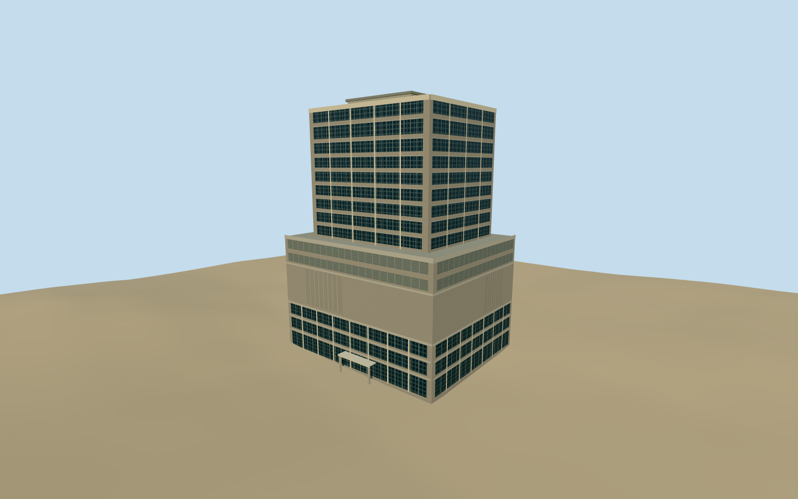

# PGGMB Building

The 17-level PGGMB Building on Jalan Kianggeh, with street podium and an upper office tower.

Authoring state: **review-in-qa.json**. Current completion evidence is in [qa.json](qa.json) and the [completion ledger](../../../../qualla-structures/batches/qualla-003.PROGRESS.md).

- [The Tallest Building in Brunei Town Was Built by Teachers](https://qualla.com/brunei-malay-teachers-association/)

Present 17-storey replacement only. It opened on the same site as the 1965 teachers’ building.

The lower envelope follows the exact native outline. The upper footprint, setbacks, roof height, entry, cladding, glazing and window rhythms are architectural estimates.

The 1965 photograph has no accepted public-domain evidence for this source. The current Qualla exterior requires attribution. Model uses written facts and original terrain.

Build: `node content/worldgen/source/places/w8/w8c/pggmb_building/models/generate-pggmb-building.mjs`. Add `--check` to verify exact regeneration. 2519 triangles; 5 materials; no embedded photographs.
