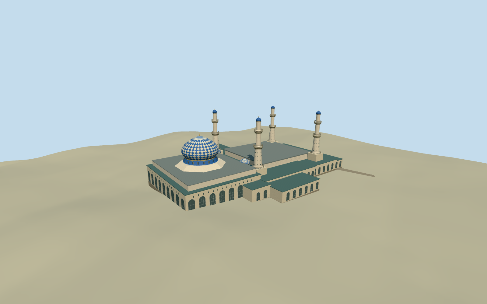

# Kota Kinabalu City Mosque

The Likas Bay floating mosque with cream arcades, a patterned blue dome, three-tier minarets and a low lagoon-side platform.

Authoring state: **review-in-qa.json**. Current completion evidence is in [qa.json](qa.json) and the [completion ledger](../../../../qualla-structures/batches/qualla-004.PROGRESS.md).

- [Kota Kinabalu City Mosque](https://qualla.com/kota-kinabalu-city-mosque/)

The roof levels, tower dimensions, ornamental spacing and elevations away from the documented faces are approximate.

The model includes the mosque and its fixed structural platforms. The lagoon is represented by mapped placement context and terrain rather than permanent water geometry in the mosque asset.

Build: `node content/worldgen/source/places/w9/w94/kota_kinabalu_city_mosque/models/generate-kota-kinabalu-city-mosque.mjs`. Add `--check` to verify exact regeneration. 21357 triangles; 7 materials; no embedded photographs.
