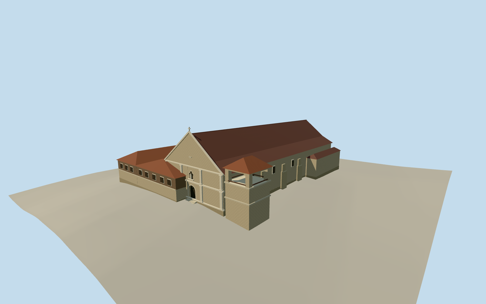

# Boljoon Church

The Boljoon coral-stone church, pedimented east entrance, buttressed nave, tiled convent and north belfry.

Authoring state: **review-in-qa.json**. Current completion evidence is in [qa.json](qa.json) and the [completion ledger](../../../../qualla-structures/batches/qualla-003.PROGRESS.md).

- [Boljoon Church](https://qualla.com/boljoon-church/)

The complete mapped church and adjoining convent follow the original sixteen-corner outline. Internal massing divisions, eaves, ornament, openings and the palette are estimates from written facts and the mapped exterior.

The north belfry location follows the museum description. Its footprint, heights and roofing profile are estimates. The separately named El Gran Baluarte and other outbuildings are outside scope.

The National Museum reports upper and lower main-roof slopes of 39 and 28 degrees and the 2007 galvanized iron covering. The position of the slope break is estimated.

The field preserves the original provider samples. The entrance and foundation are registered to approximate local grade.

Build: `node content/worldgen/source/places/w9/w9x/boljoon_church/models/generate-church.mjs`. Add `--check` to verify exact regeneration. 2248 triangles; 5 materials; no embedded photographs.
