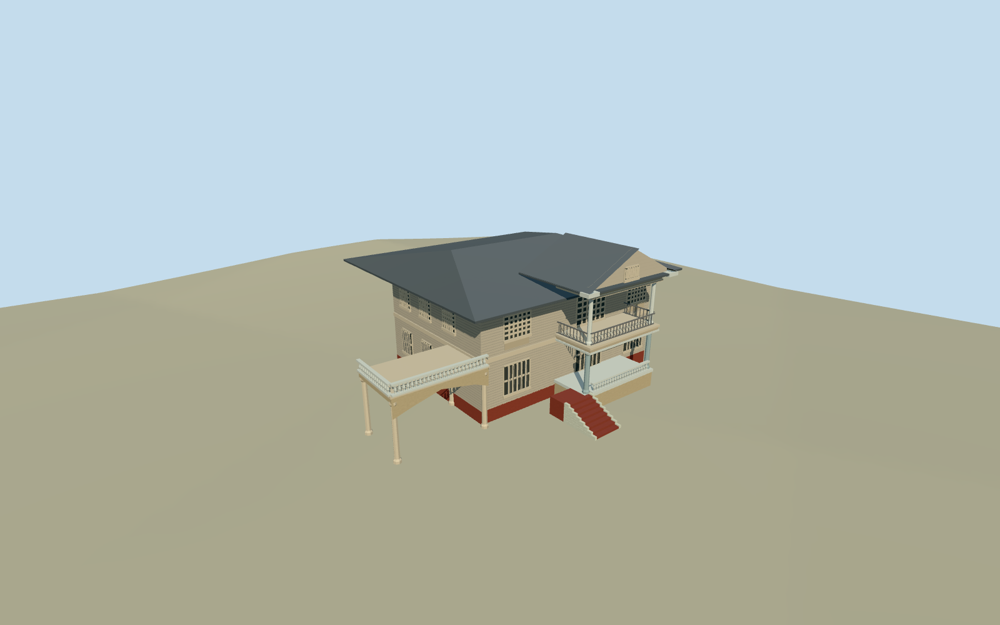

# Hofilena Ancestral House

Hofileña Ancestral House in Silay, with its two-storey porch, weatherboard exterior, broad eaves and carriage terrace.

Authoring state: **review-in-qa.json**. Current completion evidence is in [qa.json](qa.json) and the [completion ledger](../../../../qualla-structures/batches/qualla-004.PROGRESS.md).

- [Hofilena Ancestral House](https://qualla.com/hofilena-ancestral-house/)

Draft exterior: approximate photographic proportions and simplified ornament. It is not a survey, photogrammetric reconstruction or approved current geographic replacement.

The original Qualla photograph shows timber weatherboards over a painted masonry plinth, broad overhanging roofs, corner columns, metal balcony railing, red steps and an open carriage terrace.

Terrain sampling/contact, geographic alignment and site activation remain pending. Runtime LODs are produced by the registered after-import pipeline and require visual review.

Reference photos remain in the local Qualla corpus; only provenance, paths and hashes are retained here.

Build: `node content/worldgen/source/places/w9/w9z/hofilena_ancestral_house/models/generate-hofilena-ancestral-house.mjs`. Add `--check` to verify exact regeneration. 8389 triangles; 6 materials; no embedded photographs.
