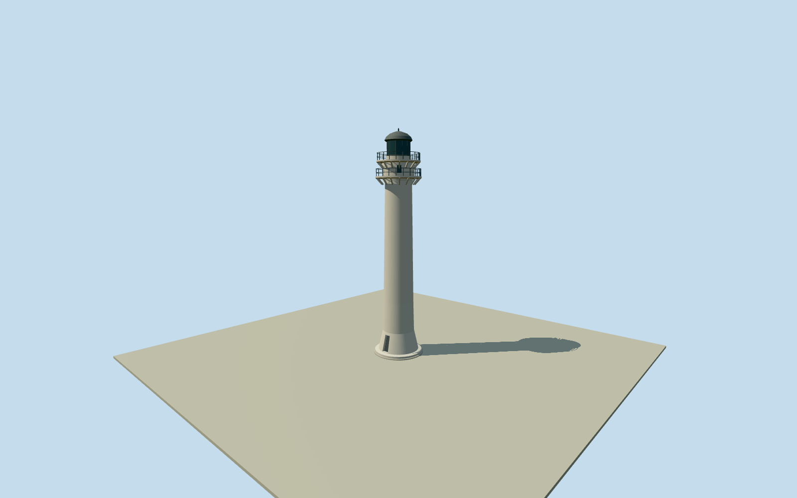

# Maniguin Island Lighthouse

Whole original1906 concrete lighthouse, exacthistoricnativepoint distinctfrommodernreplacement: splayedcylindricalshaft, twoopenrailedgalleries/corbels/watchroom, physicaldoor/windowrecesses, lantern/curvedmetalroof/finial. Historic1907 publicdomainsection informs profile; currentfinish/hiddenfaces/doorbearing unsurveyed. Detachedkeeperhouse/ruins/modernreplacement excluded.

Authoring state: **review-in-qa.json**. Current completion evidence is in [qa.json](qa.json) and the [completion ledger](../../../../qualla-structures/batches/qualla-002.PROGRESS.md).

- [Maniguin Island Lighthouse](https://qualla.com/maniguin-island-lighthouse/)

ExactnativeOldManiguinIslandLighthouse node3708631958/Q6749580 anchors wholehistoric1906tower; separatemodernlight node3708631957 isabout25.6m north, not substituted. No mappedtowerfootprint exists here; circularprofile/radii are boundedreconstruction frompublicdomain1907 section, never describedasmeasurednativeoutline. Heading0 gives +Xeast/+Zsouth; entrance/apertureazimuth is an explicit180degree visualizationapproximation, not inferredfromnode.

Originalboundedprofile/radii/windowcensus/glazingrail/cupolafaceting chosen afterimmutable400mfieldfreeze. Nativeheight29.6m usedasoverallcontrol, floor0 relativefixed29.8472m provider datum. Historic1907section isstructuralreference, notcurrentfinishsurvey; hiddenfaces/doorwindowazimuth andsmallfittings remain boundedinterpretations. No mappedperimeter invented. Facing0/entrance+Z isreviewed180degree visualizationapproximation. Exactground/thresholdcontact unresolved; nofit/flatten/reacquire.

Only exactpublished419x7811907Americansection/elevation/plan original adopted; explicitPD-US/SpencerCosby/ASCE1907publication pinned. Historicdrawing isstructuralreference, notcurrentconditionphotography. Hero/unbuiltSpanishdesign/unrelatedCorregidorimagery unselected. No newprotectedphotos/generatedbitmaps/copiedtexturepixels/article/media/rightsmetadata repairs. Tower29.6m nativeheight retained; radii/windowcensus/lanternfaceting/corbels/hiddenwalls/finish originalboundedestimates. Interiorstair/lens/keeperhouse/ruins/modernreplacement/terrain/lettering excluded.

Independent400m129x129field/16641values/oneoriginalrawtile frozen beforefloor0/profilesections. Fixed29.8472m provider datum remains independent; exactfooting/thresholdcontact unresolved. Nativepoint anchorsoriginaltower, notdrawnfootprint; doorazimuth reviewed180degreeapproximation. Geographicpreview/replaceFootprint=false; nofit/flatten/reacquire.

Build: `node content/worldgen/source/places/wd/wdn/maniguin_island_lighthouse/models/generate-maniguin-island-lighthouse.mjs`. Add `--check` to verify exact regeneration. 10790 triangles; 5 materials; no embedded photographs.
