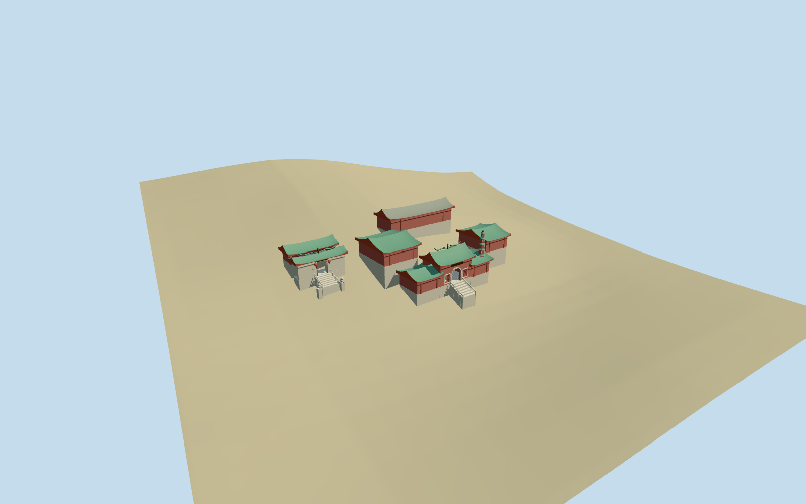

# a_ma_temple — A-Ma Temple

Reviewed2026-10-19 in one continuous author/build/inspect/fix round.

## Appearance

Inspected all 48 final current source, shared-material, medium-fi, native-site and failed-load views in this continuous round. The main red hall has a real round arched passage, pale arch trim, open lattice windows, curved green roof and slender red/white tiered pagoda at its south side. Separate ranges rise on hillside terraces around open inner courts. The northern granite gateway has an open red-jamb passage, paired curling ridge forms and central pearl, two red lanterns, stairs, balustrades and simplified seated guardian lions. The rear northern pavilion has an open post-supported porch. Roof subdivisions, terrace engineering and internal allocation are approximate; no exact hidden-room inventory.

## Shared materials and browser levels

Five reused 256-square material graphs supply granite, lime plaster, plain wood, ceramic tile and polished metal. Metric UVs and linear muted red, green, pale stone and gold tints; every shared graph is read once by the production resolver. No embedded images or unique photo atlas. Four levels contain 976 / 3656 / 6096 / 7824 triangles, at most six draws; initial skyline plus district geometry is 465876 bytes. Separate GPU attribute streams avoid duplicate uploads. Eviction releases all model geometry.

| Level | Triangles | Bytes | Draws |
| --- | ---: | ---: | ---: |
| skyline | 976 | 102080 | 1 |
| district | 3656 | 363796 | 6 |
| street | 6096 | 603844 | 6 |
| closeup | 7824 | 779708 | 6 |

Inspected current noon/late, economy/high, whole silhouettes, architectural detail, all four authored levels and transitions. The low grouped roofs and detached northern gate remain readable; skyline simplifies lattice, crests, lions and pagoda tiers while preserving both real doorway voids and the compound layout. Close levels retain curved eaves, roof texture, framed lattice and facade ornaments. Flat library stages expose terrain-relative footings; the retained native six-meter hillside and source terrain views carry contact judgment. Native fixture green fallback ground and procedural neighbors are host context, not claims about actual paving or neighboring facade appearance.

## Approximate map fit

Exact-QID way192187333 and main PMTiles building35184564276165 fix the 38.6 by 25.1-meter main compound outline and 8.2-meter height tag. Building35185722933384 about31m north supplies the separate gate/pavilion control. Native east/south at heading0, internal architectural angle+1.472357881276 radians. Ordinary west-side photographs resolve the viewed facade direction toward local+v. Only those two native shells are replaced, with a2cm numeric mask margin; all683 independent in-tile buildings remain byte-equivalent at every loaded level. Preserve native ground and water, using separately sampled buried foundations for each hall/gate/pagoda/lion and open native-grade inner courts. Four loaded levels retain683 native buildings; failed loading retains all685 originals; unloading restores ground/water and releases geometry.

## Limits

Accepted medium-fi exterior visualization from three inspected ordinary pictures and standard PMTiles/Mapzen data. Hall allocation and subdivisions inside the broad main outline, court dimensions, roof heights/profiles, pagoda center and seven-tier10.8m form, terrace/threshold engineering, lion anatomy and ridge figures remain explicit visual approximations. Coarse six-meter terrain does not resolve actual paving or low retaining walls; some platforms and approach steps are exaggerated by this grade approximation. Fine lettering, exact inscriptions, furnishings, incense coils, individual ceramic figures, trees and event trussing are omitted. Physical-device and dense-city timings remain pending.

## Selected checks

Six Khronos files: zero errors/warnings.298 actual geometry/contact probes; 48 current inspected views. Scene validation/sim30 and strict selected medium-fi audit pass. Source and runtime hashes/material bindings/LOD caps verified.

Rebuild: node packages/worldgen/scripts/generate-additional-landmarks.mjs --ids=a_ma_temple; node packages/worldgen/scripts/import-structure-models.mjs --ids=a_ma_temple; node packages/tooling/scripts/generate-landmark-lods.mjs --ids=a_ma_temple --force.

Source: sha256:5c53b9fc59b05b7d412ff0d52e93c2220df75bbb5679a2f0dd3c3f86de4fb084

Runtime: sha256:478f9781403601b2e06655f0853a66eca3be89b7af5bbf8455c06fc16566886a

Input: sha256:9d928f83e2b7f26c46c0ee9b03760926b268c66330f8b964fa0de30a3a4c36e1

## Viewed ordinary pictures

https://commons.wikimedia.org/wiki/File:A-Ma_Temple,_2023_(01).jpg — Bahnfrend; CC BY-SA4.0; viewed only. Viewed only; no pixels copied.

https://commons.wikimedia.org/wiki/File:A_Ma_Temple_inside.JPG — Santosdo; CC BY-SA3.0; viewed only. Viewed only; no pixels copied.

https://commons.wikimedia.org/wiki/File:A-Ma_Temple_(Macau)_01.JPG — Abasaa; Public domain dedication; viewed only. Viewed only; no pixels copied.
