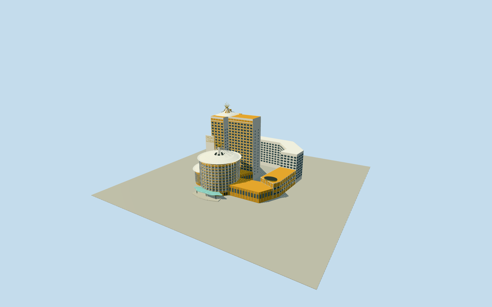

# Casino Lisboa (Macau)

Complete original Hotel/Casino Lisboa from native circular front tower/T-shaped rear tower/bent eastern wing, plus bounded inferred low connectors/west domed annex, aqua scalloped entrance canopy and signboard. Ochre walls, dark recessed glazing, strong white vertical/curving and octagonal relief window tracery, stepped wing heights, three flared white ribbed roof/open-fin crowns with genuinely pierced gold radial finials, intrinsic entry platforms/stairs and original geometric name lettering. Native site boundary is not a building slab. Separate GrandLisboa/BankofChina/Wynn/roundabout/transit pavilion and landscape excluded; hidden layout/sections/height conventions/contact are estimates.

Authoring state: **review-in-qa.json**. Current completion evidence is in [qa.json](qa.json) and the [completion ledger](../../../../qualla-structures/batches/qualla-002.PROGRESS.md).

- [Casino Lisboa (Macau)](https://qualla.com/casino-lisboa-macau/)

Named native oldHotelLisboa resortway1313391925contains the named CasinoLisboa/Q1047611node12156894048andHotelLisboanode13679896101. All24site-boundary vertices and all19circular-building/8rearT-tower/9bent-east-wing native corners are retained separately. These are original-Lisboa controls; separate GrandLisboaways192182404/405/Q1033099andBankofChina/Wynn are excluded. Landuse boundary/forecourt is NOT a solid building footprint. Mapping supplies only3parent roof/building masses; low connecting podium, west domed annex, additional height tiers/curves/roof crowns are bounded photographic interpretations inside this named complex. Native heights37.4/76.8/37.3m are source tags, not a sectional survey; their exact roof/eave conventions and conflicts with visible multi-tier proportions must be documented rather than blindly extruded. Hidden rear/service layouts, section heights and grade/host contact remain estimates.

Main circular body37.4m with9interpreted room tiers/low entrance level/open upper belt; native rear T-body76.8m with19interpreted room tiers; rear eastern wing37.3m and front wing17.8m use an inferred stepped split. White flared crowns/open upper fins/gold finials extend above these parent body heights. Native source height tags are retained separately and are not claimed verified roof-tip heights. West elliptical drum/low connectors/canopy are photographically inferred inside the named complex, with no separately surveyed footprint. Concealed rear elevations, room/floor counts, exact roof sections, podium boundaries and host grade/contact remain estimates.

Three exact published Qualla originals inspected first: two4080x3060March2026own-workCC0frontage/canopy views byNuMezzaliaOK LA R0316and one2304x3072Cdip150own-workPD-selfview used only for its visible old-Lisboa cylindrical white tracery/crown/finial. Native imageSHA1and primary same-author dedications match local originals. Neighboring BankofChina in the latter image is unused. An older640x480PDnight view was inspected for discovery but not adopted; other licensed/unrelatedGrandLisboa images unused. No additional image source or photographic texture.

White vertical fins, rounded and octagonal geometric window surrounds/recesses, lower flared sheet-roof ribs, genuinely open upper roof fins and gold basket/firework finials are original medium-fi geometry. Fine pattern census, particular decorative motifs, individual roof corrugations/bolts, signage font, exact gold sculpture and weathering are simplified. Plain original geometric CASINO/LISBOAname lettering is included; decorative billboard mural, logos/brands, character artwork and fine roof sculpture are not reproduced.

Main cylindrical and rear T-tower windows have genuine close-detail recesses. Fine wing windows use shallow relief frames with progressively simpler panes at distance. Columns, roof ribs/finials and small window ornament retire progressively; all native parent outlines remain. 

Only intrinsic connected buildings, small entry platform/steps and scalloped canopy are included. No entire resort slab/filled forecourt, roundabout/transit glass pavilion, roads, planting/people/vehicles, separate GrandLisboa/BankofChina/Wynn or surrounding towers. Fixed main-front reference was selected before terrain; source relief is retained and exact thresholds/foundation/host contact remain unverified.

Build: `node packages/worldgen/scripts/generate-authored-places.mjs --ids=casino_lisboa_macau`. Add `--check` to verify exact regeneration. 62072 triangles; 8 materials; no embedded photographs.
